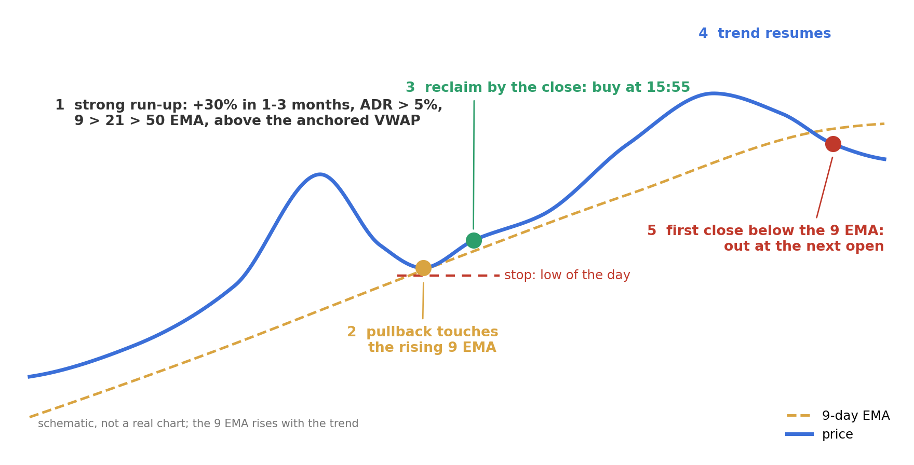
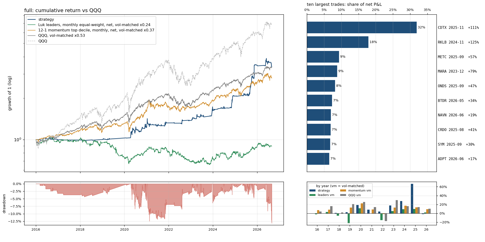

# Martin Luk's pullback strategy: a point-in-time backtest

Martin Luk won the 2025 U.S. Investing Championship (+969.8%, verified accounts) with a discretionary swing method he
has described in interviews: buy the strongest stocks when they pull back into a rising moving average, stop at the low
of the day, risk 0.5% per trade, trail the 9-day EMA. This repository codes the parts he states as rules, backtests them
on CRSP daily data plus TAQ 1-minute prints and NBBO quotes (2016-01 to 2026-08), compares them with passive benchmarks
at the same volatility, and removes one logic block at a time.

Conclusion: in this sample the mechanical rule has a modest positive record, and the ablations place it in the
pullback timing: buying a strong stock whenever it is near its 9 EMA, or holding what his screen selects, loses money
after costs. The record is concentrated in a handful of trades and in three or four years out of ten, there is no clean
out-of-sample period, and nothing in the data approaches his returns. The rule therefore explains at most a small part
of the original strategy's performance; the rest lies in what the rule does not contain (stock choice, trade frequency,
exposure, when to sit out), which a backtest of the rule cannot test.

Contents: [strategy](#1-the-strategy) · [sources](#2-sources) · [runs](#3-what-is-tested) · [data and execution](#4-data-and-execution-model) ·
[results](#5-results) · [interpretation](#6-interpretation) · [reproduce](#7-reproducing-the-results) · [layout](#8-repository-layout)

## 1. The strategy

His rules in his order. "Hard" = stated as a rule; "tendency" = a preference without a number. `specs.py` marks every
parameter as his or ours.

| step | his rule | status | coded as (`specs.BASE`) |
|---|---|---|---|
| 1. leaders | ADR above 5%; liquid (his "premier" tier trades $100M+ a day); "leading" list = daily 9 > 21 > 50 EMA; above the anchored VWAP; a strong recent run | ADR hard, rest tendency | `min_adr=0.05`, `min_dollar_volume=50e6`, `ema_stack="9>21>50"`, `above_avwap=True` (anchor: 250-day high), `min_run_up=0.30` over 1 or 3 months (a third party's threshold) |
| 2. pullback | "at least the daily 9 EMA"; slower EMAs and confluences are better but rarer | hard | `support="ema9"`: the low trades at or through the prior day's 9 EMA, at most 1 ADR below |
| 3. entry | a fast flush into support in the first hour, buy the break of the previous 1-minute (first 15 min) or 5-minute bar high, never more than 3% off the low | hard | `entry="morning_breakout"` loses after spreads (section 5); the tested `entry="close_confirm"` requires at 15:54 that the stock has reclaimed the support and sits in the upper 60% of its range, and fills at the 15:55 open |
| 4. stop | the low of the day; width under 5% and under half the ADR | hard | `max_stop_width=0.05`, `max_stop_width_adr=0.5` on the planned width (decision price to stop); `min_stop_width=0.02` is ours |
| 5. sizing | 0.5% of the account at risk per trade; positions 20-30%, up to 35%; gross up to 280% in 2025; 3-4 positions, up to 11; no longs with the index under its 9/21 EMAs | 0.5% hard, rest tendency | `risk_per_trade=0.005`, `max_position_pct=0.30`, `max_gross_exposure=2.8`, `max_positions=10`, `market_filter="qqq_9>21"` |
| 6. exits | sell 10-15% at 3-5R; out on the first daily close below the 9 EMA; winners 1-3 weeks, losers cut the same day | tendency | `partial_at_r=3.0`, `partial_fraction=0.15`, `exit_ema=9` (next open), `max_hold_days=15` |
| 7. costs | spreads and commissions on 900+ trades a year | | NBBO half-spread of the fill minute, per-share commission, SEC and FINRA fees, margin at T-bill + 1.5%, idle cash at T-bill |



The entry is the one deliberate departure from his words. His morning entry pays first-hour spreads (3-8 times the
closing spread in these names) and shows no edge even before costs. The 15:55 entry is the nearest mechanical statement
of what he buys: a stock that touched the 9 EMA and reclaimed it the same day.

## 2. Sources

Primary:

- TraderLion podcast, 2025-04-06, *283% Gain in 1 Year* (breakouts, scans, stops, sizing, 2024 statistics): https://www.youtube.com/watch?v=lS9zbnLi1Gg
- TraderLion podcast, 2026-01-31, *+969% Return in 1 Year: The Pullback Strategy* (pullback definition, 1/5-minute triggers, AVWAP anchors, 2025 statistics): https://www.youtube.com/watch?v=VKNEJA5r8zw
- Luk's guest article, 2025-02-01 (scans, EMA tiers, stop 1-5% and under half the ADR, risk 0.5-1%): https://tradingresourcehub.substack.com/p/martin-luk-283-usic-2024-key-lessons
- Championship results: https://www.businesswire.com/news/home/20260202090143/en/ and https://completetradersedge.com/wp-content/uploads/2026/09/CTE-Research-Sheet-US-Investing-Championship-2.pdf

Secondary (their thresholds, not his):

- Financial Wisdom (adds ">30% in 1/3/6 months", ">8 weeks base"): https://www.financialwisdomtv.com/post/martin-luk-s-pullback-trading-strategy-how-the-2025-u-s-investing-champion-finds-low-risk-high-re , https://www.financialwisdomtv.com/post/martin-luk-s-1358-swing-trading-strategy-from-gamestop-blow-up-to-us-investing-champion
- Finetiq's mechanical "AVWAP-EMA flush" (anchor at the 250-day high, tolerances in ADR units, untested): https://ideas.finetiqsystems.com/en/ideas/avwap-ema-flush/
- Kyna Kosling on his study process: https://tradingresourcehub.substack.com/p/martin-luk-study-process
- Summaries: https://en.forexclub.pl/Martin-Luk-969-in-a-year-who-is-the-winner-of-the-US-Investing-Championship-and-how-does-he-trade/ , https://etrading.substack.com/p/martin-luk-ep1

His own numbers: 2024, 104 wins / 319 losses, average win +15%, average loss -3%, +340% with a 30% drawdown; 2025,
209 / 731, +970%, a 26% drawdown in December. One transcript says "5% risk"; the article and the 2026 interview say 0.5%.

## 3. What is tested

The rule is three blocks: momentum selection (step 1), pullback timing (steps 2-3), trend-following exit (step 6).
Each run removes one block or changes one parameter; everything else stays fixed.

| run | what changes |
|---|---|
| `full` | the specification above |
| `no_timing` | buys a strong stock on any day it trades within half an ADR of its 9 EMA by 15:54, without the touch, the reclaim or the strong close; same stops and exits. "Any day of a strong stock" needs minute bars for every stock-day, which the data does not have; the universe-hold benchmark covers that case |
| `no_trail` | keeps the timing, holds a fixed 10 days with the stop only: no EMA exit, no partial |
| `support_ema5`, `support_ema13` | the pullback level |
| `no_avwap` | drop the anchored-VWAP condition |
| `adv_10m` | admit names trading $10M+ a day instead of $50M+ |
| `risk_1pct` | the same trades at 1% risk |
| `exit_ema21` | a slower trailing exit |

Passive benchmarks, same pool (common stocks, price $5+, 20-day dollar volume $50M+), same spread table plus
commission, selected on the day before each month end, bought at the month end's close, held a month: QQQ total return;
the top decile of 12-1 momentum, equal weight; and a "universe hold" of every stock passing Luk's leader screen. Each is
also shown as a fraction of the benchmark plus T-bills, scaled to the strategy's realised volatility ("vm"), since the
strategy is in cash most of the time.

## 4. Data and execution model

Data (WRDS): CRSP daily securities (CIZ format, delisting rows, total returns); Daily TAQ trades for every candidate
stock-day (324,807 stock-days on 2,680 days, 99.98% with prints) and every held day, regular uncorrected prints only;
the NBBO quote before each fill minute; Fama-French five factors plus momentum. Symbol changes and share classes are
mapped through CRSP trading symbols.

Point-in-time rules:

- Every feature is from the prior close; the only same-day inputs are minute bars up to the decision minute.
- The 15:54 decision fills at the first print from 15:55 on, within five minutes; a fill at or below the low of day is stopped at once.
- Stops fill at the open of the minute that traded through them when that is worse; gaps through the stop fill at the open and pay the spread. Partials need the same minute confirmation as stops.
- Quantity is fixed at the decision price (risk, position cap, exposure room) on the prior close's account value and marks; a signal with room for less than a quarter of its intended size is skipped rather than scaled down.
- Events run in minute order; within a minute, fills at the minute's open come before fills within it, then entries before exits. Bars with no prints and halted days fill nothing.
- Partials are whole raw shares; P&L is split-adjusted; dividends come from CRSP total returns; delistings settle at the delisting return with no spread or commission.
- Idle cash earns T-bill, borrowed cash pays T-bill + 1.5%; per-share commission with a minimum per order; SEC and FINRA fees follow their schedules.
- Every fill pays the half-spread of the last NBBO quote in the five minutes before it (a liquidity-tier median from TAQ when no quote exists); a market order filled at the open (a gap through the stop) has no quote before it and pays the measured morning-tier median; auction fills pay no spread.

Validation: `selfcheck.py` runs 43 checks on synthetic data (event order, stop and partial fills with and without
minute confirmation, sizing and the market filter's timing, split units, fees, financing, delistings including a full loss,
halts, benchmark holding and rebalance costs, the feature kernel against a pandas reference, download coverage, bar
validation) plus one perturbation test on real minute bars showing that nothing after the decision minute changes a
decision. The code went through several independent reviews. The backtest refuses
an incomplete download, and every result folder's `spec.json` records the spec, the code hash, the data version (download run id plus
minute-bar coverage) and the git commit when run inside a repository. A GitHub Actions workflow runs the synthetic checks on every push.

## 5. Results

After costs, 2016-01-04 to 2026-08-31, from `results/overview.md`. "6-factor alpha": the intercept of a regression of the
run's daily returns in excess of the T-bill rate on the six Fama-French factors (market, size, value, profitability,
investment, momentum), multiplied by 252; the return per year that the factor exposures do not explain. The t in brackets
uses Newey-West standard errors (5 lags). "beta" is the market loading from the same regression. "vm": the benchmark scaled to the strategy's
volatility, with the remainder in T-bills (as the strategy's idle cash is). "Sharpe": annualised mean of daily
returns in excess of the T-bill rate over their standard deviation. "avg % invested": capital utilisation, open positions as a share of net asset value averaged over all days
(the rest earns T-bill); the share of days with a position is 28% for `full`. "profit/loss ratio": gross profits over
gross losses.

### The strategy and its logic blocks

| | CAGR | vol | Sharpe | max DD | 6-factor alpha/yr (t) | beta | trades/yr | win | avg win | avg loss | avg trade | profit/loss ratio | avg % invested |
|---|---|---|---|---|---|---|---|---|---|---|---|---|---|
| **full** | 12.1% | 11.8% | 0.83 | -13% | 9.6% (2.5) | 0.04 | 27 | 29% | 14.3% | -2.9% | 2.10% | 1.98 | 8% |
| no_timing | 7.1% | 35.7% | 0.30 | -62% | 8.9% (0.8) | 0.29 | 239 | 29% | 8.3% | -3.0% | 0.27% | 1.07 | 48% |
| no_trail | 12.1% | 12.8% | 0.78 | -13% | 9.6% (2.3) | 0.05 | 27 | 21% | 22.4% | -3.3% | 2.10% | 1.79 | 8% |

### Passive benchmarks, same pool, same costs

| | CAGR | vol | Sharpe | max DD | 6-factor alpha/yr (t) | beta |
|---|---|---|---|---|---|---|
| QQQ | 19.9% | 22.3% | 0.83 | -35% | 3.0% (1.9) | 1.11 |
| QQQ vm (x0.53) | 12.0% | 11.8% | 0.83 | -19% | 1.6% (1.9) | 0.59 |
| 12-1 momentum top decile | 21.0% | 32.1% | 0.68 | -46% | 7.5% (1.7) | 1.17 |
| momentum vm (x0.37) | 10.2% | 11.8% | 0.68 | -18% | 2.7% (1.7) | 0.43 |
| universe hold (Luk leader screen) | -19.2% | 50.2% | -0.22 | -95% | -19.3% (-1.6) | 0.90 |
| universe hold vm (x0.24) | -1.0% | 11.8% | -0.22 | -37% | -4.6% (-1.6) | 0.21 |

### Sensitivity, one parameter at a time

| | CAGR | vol | Sharpe | max DD | 6-factor alpha/yr (t) | trades/yr | win | avg trade | profit/loss ratio | avg % invested |
|---|---|---|---|---|---|---|---|---|---|---|
| support_ema5 | 7.2% | 14.1% | 0.40 | -18% | 5.1% (1.1) | 45 | 22% | 0.78% | 1.27 | 12% |
| support_ema13 | 5.3% | 8.6% | 0.37 | -11% | 3.2% (1.2) | 18 | 35% | 0.93% | 1.65 | 3% |
| no_avwap | 18.2% | 18.5% | 0.87 | -27% | 15.7% (2.6) | 74 | 26% | 1.46% | 1.55 | 19% |
| adv_10m | 16.8% | 18.3% | 0.82 | -30% | 14.1% (2.3) | 73 | 28% | 1.27% | 1.52 | 20% |
| risk_1pct | 17.4% | 18.3% | 0.84 | -23% | 15.0% (2.4) | 27 | 29% | 2.10% | 1.87 | 12% |
| exit_ema21 | 11.1% | 12.9% | 0.70 | -16% | 8.7% (2.1) | 27 | 22% | 1.91% | 1.79 | 9% |

### The full specification over time



| year | strategy | QQQ | QQQ vm | momentum vm | universe vm | trades | win | avg trade | max DD in year |
|---|---|---|---|---|---|---|---|---|---|
| 2016 | -0.2% | 7.1% | 4.1% | 7.1% | -2.4% | 9 | 22% | -0.05% | -3% |
| 2017 | -0.5% | 32.7% | 16.4% | 8.1% | 2.9% | 1 | 0% | -2.16% | -1% |
| 2018 | 0.8% | -0.1% | 1.8% | 0.1% | -5.4% | 3 | 0% | -3.08% | -1% |
| 2019 | 2.6% | 39.0% | 20.9% | 12.8% | -22.1% | 7 | 43% | 0.30% | -2% |
| 2020 | 19.0% | 48.6% | 25.8% | 22.4% | 11.4% | 68 | 28% | 1.40% | -8% |
| 2021 | 8.2% | 27.4% | 14.2% | 8.7% | -0.9% | 43 | 30% | 0.79% | -12% |
| 2022 | 4.2% | -32.6% | -17.4% | -1.8% | -15.1% | 13 | 31% | 0.73% | -2% |
| 2023 | 17.5% | 54.9% | 29.7% | 12.8% | 5.3% | 26 | 35% | 4.21% | -6% |
| 2024 | 27.7% | 25.6% | 16.0% | 17.0% | 9.3% | 25 | 40% | 3.98% | -4% |
| 2025 | 66.7% | 20.8% | 13.9% | 13.5% | 10.0% | 52 | 33% | 5.33% | -5% |
| 2026 (to Aug) | -1.9% | 17.0% | 10.2% | 9.3% | 2.1% | 40 | 18% | -0.34% | -13% |

Concentration and robustness of `full` (details in `results/full/summary.md`):

- The ten largest trades are 111% of net P&L; CDTX (2025-11) alone is 32%, RKLB (2024-11) 18%.
- The top 5% of trades are 65% of gross wins. Without the best 1% (two trades) the average trade drops from 2.10% to 1.35% and the profit/loss ratio from 1.98 to 1.49.
- Block bootstrap (20-day blocks): Sharpe 90% interval 0.46 to 1.29; max drawdown median -12%, 5th percentile -18%.
- Costs: Sharpe 0.90 with zero slippage, 0.62 with 0.2% per side, 0.5% stop slippage and 8% margin.
- Capacity is not binding: at $1M the median position is 0.15% of the stock's 20-day dollar volume.
- His own morning entry (`morning_breakout`, under "other runs" in the overview): 166 trades a year, 13% winners, average trade +0.40% with zero slippage and +0.04% with measured spreads (CAGR -2.2%, drawdown -59%). The entry only works with his execution.

## 6. Interpretation

**Where the return comes from.** Without the touch-and-reclaim rule the profit/loss ratio is 1.07 and the drawdown 62%;
holding what his screen selects loses 19% a year. Within this sample the measured edge is the timing: trade into the
9 EMA and close back above it, in the upper part of the range, the same day. The trailing exit adds little (no_trail is within noise of
full); a stop plus a fixed hold captures most of it. A market beta of 0.04 and a 6-factor alpha of 10% a year (t 2.5) say it is not disguised
market or momentum exposure, but the evidence is one sample of about 290 trades.

**It is a regime strategy.** 2016-2019: 20 trades, a small net loss. The return is 2020, 2023, 2024 and above all 2025
(+67%, with CDTX a third of the ten-year P&L). The setup needs many stocks up 30% in a month or a quarter with a 5%
daily range, above all three EMAs and their anchored VWAP, while QQQ is above its 21 EMA. That describes 2020-21 and
2023-25, not 2016-19 or 2022. When it holds the rule prints money; otherwise it finds almost nothing and sits in T-bills,
which is also why drawdowns are shallow. Its Sharpe ratio equals QQQ's (0.83), so there is no risk-adjusted advantage; what the rule
offers is a return stream uncorrelated with the index, in some years.

**Why not +969%.** Per trade the shape matches his: 29% winners, +14% / -3%, payoff 4.8 (his 2024: 23%, +15% / -3%). The
gap is frequency and exposure: 900+ trades in 2025 at up to 280% gross, against 27 a year and 8% of the account in
stocks on average. At 1% risk the same trades give 17.4% a year with a 23% drawdown, and scaling further scales the
drawdowns. The rest is outside the rule: which of the qualifying stocks, when to add, when to step aside. This backtest
says nothing about whether those choices carry skill.

**What to distrust.** The 9 EMA is a sharp peak (5 and 13 cut the per-trade edge by more than half); it is his stated level, not tuned,
but that fragile a result is one draw. The 30% run-up and the 15:55 entry are our choices made with the data in view,
so there is no clean out-of-sample period; the honest test is forward from 2026-09. The 250-day-high AVWAP stands in
for an anchor he places by hand; removing it triples the trade count at a similar Sharpe, so it mostly cuts signals
rather than selecting them. Delistings, halts, splits, dividends and gap-through stops are handled, but 1-minute bars
understate what a fast market does to a stop order.

**What the engineering buys.** Every decision uses only what was known at that minute, every fill pays that minute's
quote, and the chain from WRDS to these tables reruns from a handful of commands. That is enough to say what the rule does. It is
not enough to say it will work next year.

## 7. Reproducing the results

WRDS account with CRSP, TAQ and Fama-French access, credentials in `~/.pgpass` (never in the repository).

```bash
python3 -m venv .venv && source .venv/bin/activate     # Python 3.12
pip install -r requirements.txt                        # the versions the results were produced with
python3 selfcheck.py                                   # engine checks, no data needed, exit code 1 on failure
python3 data.py prepare --shards 4                     # CRSP, factors, feature panel, candidate stock-days, the frozen download plan
for i in 1 2 3 4; do python3 data.py download --shard $i & done; wait    # four workers, about two hours; re-run to resume
python3 data.py status                                 # coverage by year
python3 backtest.py                                    # all logic and sensitivity runs -> results/<name>/, results/overview.md
python3 backtest.py full morning_breakout              # any subset
```

The candidate gate in `config.py` is wider than any spec, so `specs.py` can change without re-downloading; a spec outside
the gate is refused. Held-day bars and fill quotes are pulled on demand during the backtest.

## 8. Repository layout

| file | role |
|---|---|
| `config.py` | paths, sample window, WRDS tables, fee schedules, candidate gate; no strategy parameters |
| `wrds_db.py` | one SQL function with retries |
| `data.py` | `prepare`, `download`, `status`: CRSP, factors, panel, candidates, minute bars, NBBO |
| `features.py` | daily feature panel (EMAs, ADR, dollar volume, run-ups, anchored VWAP), numba kernel |
| `specs.py` | the specification in Luk's seven steps, and the runs |
| `entry.py` | universe mask and the two entry models on minute bars, cached per data version |
| `portfolio.py` | daily simulation: sizing, stops, partials, exits, financing, corporate actions |
| `report.py` | benchmarks, metrics, factor regression, chart, `summary.md` |
| `backtest.py` | runs a spec to convergence, writes `results/` |
| `selfcheck.py` | engine checks and the point-in-time perturbation test |
| `results/<name>/` | `spec.json`, `metrics.json`, `summary.md`, `cumret.png` (trade and daily tables not committed) |
| `results/overview.md` | all runs and benchmarks in one table |
| `setup.png` | the schematic in section 1 |
| `requirements.txt` | pinned dependencies |
| `.github/workflows/selfcheck.yml` | runs `selfcheck.py` on every push |

`data/` is not committed (several GB from WRDS; about eight CPU-hours of TAQ queries).
