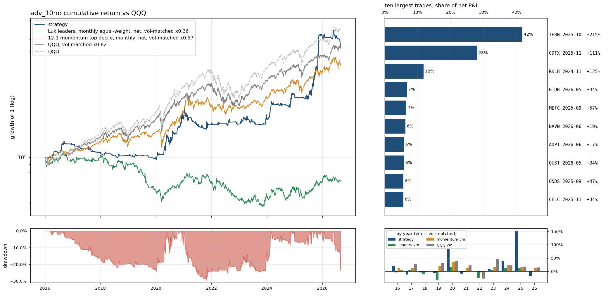

# `adv_10m`: the liquidity floor lowered from $50M to $10M of 20-day dollar volume

Same as `full` (see `results/full/summary.md`) except: `min_dollar_volume` 50000000.0 -> 10000000.0.

Sample 2016-01-04 to 2026-08-31, starting capital $100,000, code `cb16764382`.  
Entry `close_confirm` on the `ema9` pullback, 0.5% of the account at risk per trade, at most 10 positions and 280% gross, market filter `qqq_9>21`, slippage `nbbo`, stop fill `minute_open`, financing T-bill + 1.5%; idle cash earns the T-bill rate.
- note: 73 candidate stock-days were queried and had no eligible print (empty)
- note: 7844 of 324807 candidate stock-days were too thinly traded for close_confirm (min_bars / max_stale_minutes)

## Headline

| trades | win rate | avg win | avg loss | payoff | avg trade | profit/loss ratio | median hold win / loss (days) | avg % invested | longest underwater |
|---|---|---|---|---|---|---|---|---|---|
| 781 (73/yr) | 28% | 12.5% | -3.0% | 4.2 | 1.27% | 1.52 | 10 / 2 | 20% | 3.7 yr |

Avg % invested = capital utilisation: market value of open positions / net asset value, averaged over all trading days (the rest earns the T-bill rate); profit/loss ratio = gross profits / gross losses.

The strategy against passive benchmarks, all after costs, all on daily returns. 6-factor alpha is the intercept of daily excess returns regressed on the Fama-French factors (market, size, value, profitability, investment, momentum), times 252: the return per year the factor exposures do not explain; t uses Newey-West errors (5 lags); beta is the market loading.

|  | CAGR | vol | Sharpe | max drawdown | 6-factor alpha / yr (t) | market beta |
|---|---|---|---|---|---|---|
| **strategy** | 16.8% | 18.3% | 0.82 | -30% | 14.1% (2.3) | 0.11 |
| QQQ (total return) | 19.9% | 22.3% | 0.83 | -35% | 3.0% (1.9) | 1.11 |
| QQQ, vol-matched x0.82 | 17.0% | 18.3% | 0.83 | -29% | 2.5% (1.9) | 0.91 |
| 12-1 momentum top decile (87 names), net | 21.0% | 32.1% | 0.68 | -46% | 7.5% (1.7) | 1.17 |
| momentum, vol-matched x0.57 | 14.0% | 18.3% | 0.68 | -28% | 4.2% (1.7) | 0.67 |
| universe hold: Luk leader screen (16 names), net | -19.2% | 50.2% | -0.22 | -95% | -19.3% (-1.6) | 0.90 |
| universe hold, vol-matched x0.36 | -3.4% | 18.3% | -0.22 | -56% | -7.0% (-1.6) | 0.33 |

Passive benchmarks: equal-weight portfolios in the same liquidity pool (common stocks, price >= $5, 20-day dollar volume >= $50M), selected on the day before each month end, bought at the month end's close and held for the month, net of the same spread table plus commission. Vol-matched = a fraction k of the benchmark, chosen so the realised volatility equals the strategy's, with the rest in T-bills. Sharpe = annualised mean of daily returns in excess of the T-bill rate over their standard deviation.

## By year

| year | strategy | QQQ | QQQ vm | momentum vm | universe vm | trades | win | avg trade | max DD in year |
|---|---|---|---|---|---|---|---|---|---|
| 2016 | 21.4% | 7.1% | 6.0% | 11.1% | -4.1% | 34 | 35% | 4.10% | -5% |
| 2017 | -11.6% | 32.7% | 26.2% | 12.7% | 4.2% | 22 | 9% | -3.10% | -12% |
| 2018 | -4.1% | -0.1% | 0.7% | -1.7% | -10.1% | 28 | 14% | -0.99% | -8% |
| 2019 | -4.7% | 39.0% | 31.8% | 18.5% | -33.3% | 29 | 14% | -1.41% | -6% |
| 2020 | 83.4% | 48.6% | 39.9% | 34.7% | 17.0% | 174 | 36% | 2.11% | -13% |
| 2021 | -8.4% | 27.4% | 22.3% | 12.5% | -1.9% | 117 | 21% | -0.57% | -30% |
| 2022 | 0.6% | -32.6% | -26.9% | -4.1% | -23.4% | 40 | 30% | -0.09% | -8% |
| 2023 | 7.6% | 54.9% | 44.8% | 16.9% | 4.8% | 67 | 25% | 0.83% | -12% |
| 2024 | 39.5% | 25.6% | 21.9% | 23.4% | 10.8% | 67 | 36% | 2.76% | -9% |
| 2025 | 151.3% | 20.8% | 18.3% | 17.2% | 12.0% | 129 | 30% | 4.10% | -8% |
| 2026 | -16.2% | 17.0% | 14.4% | 12.3% | 1.6% | 74 | 19% | -1.07% | -24% |

## Factor attribution

Daily excess returns on the Fama-French 5 factors plus momentum (Newey-West t-statistics).

|  | days | 6-factor alpha / yr | R² | mkt | smb | hml | rmw | cma | umd |
|---|---|---|---|---|---|---|---|---|---|
| all days | 2680 | 14.1% (t 2.3) | 0.07 | 0.11 (4.4) | 0.28 (6.1) | 0.02 (0.6) | -0.16 (-3.1) | 0.02 (0.2) | 0.00 (0.1) |
| invested days only | 1346 | 20.6% (t 1.7) | 0.14 | 0.44 (7.9) | 0.42 (5.4) | 0.05 (0.7) | -0.29 (-3.1) | 0.05 (0.3) | 0.04 (0.9) |

## Largest trades

| ticker | entry | exit | exit reason | return | P&L | share of net P&L |
|---|---|---|---|---|---|---|
| TERN | 2025-10-31 15:55 | 2025-11-21 09:30 | max_hold | +215% | $158,889 | 42% |
| CDTX | 2025-11-10 15:55 | 2025-12-02 09:30 | max_hold | +111% | $106,389 | 28% |
| RKLB | 2024-11-04 15:55 | 2024-11-25 09:30 | max_hold | +125% | $44,741 | 12% |
| BTDR | 2026-05-20 15:55 | 2026-06-08 09:30 | close_below_ema9 | +34% | $25,532 | 7% |
| METC | 2025-09-17 15:55 | 2025-10-08 09:30 | max_hold | +57% | $24,922 | 7% |
| NAVN | 2026-06-23 15:55 | 2026-07-15 09:30 | max_hold | +19% | $23,941 | 6% |
| ADPT | 2026-06-18 15:55 | 2026-07-09 09:30 | close_below_ema9 | +17% | $22,312 | 6% |
| OUST | 2026-05-20 15:55 | 2026-06-08 09:30 | close_below_ema9 | +34% | $22,168 | 6% |
| ONDS | 2025-09-09 15:55 | 2025-09-30 09:30 | max_hold | +47% | $21,689 | 6% |
| CELC | 2025-11-07 15:55 | 2025-12-01 09:30 | max_hold | +34% | $21,498 | 6% |

Each year's largest trade against the year's net P&L: 2016 CWEI $8,658 / $21,366; 2017 MYOK $549 / $-14,707; 2018 IMMR $3,830 / $-6,274; 2019 VYGR $1,896 / $-8,238; 2020 MAXR $14,898 / $84,044; 2021 SBH $10,470 / $-16,450; 2022 SWAV $11,945 / $-1,045; 2023 MARA $19,571 / $9,564; 2024 RKLB $44,741 / $57,912; 2025 TERN $158,889 / $354,113; 2026 BTDR $25,532 / $-99,507.

## Risk

- Concentration: the top 5% of trades are 70% of gross wins; without the best 1% (7 trades) the average trade is 0.60% and the profit/loss ratio 0.96.
- Trade returns (net): p5 -4.8%, median -2.5%, p95 20.7%, best 193.0%, worst -14.4%.
- Gap-through stops: 45 trades (5.8%), $-106,782 of the $380,778 net; losses beyond twice the planned risk: 16; closed by delisting: 0; dividends credited $2,035; halted position-days: 0.
- Worst five: SYRE 2026-08-20 -14.4% (stop_gap); ACOR 2017-08-16 -12.9% (stop_gap); DAVE 2024-12-30 -11.8% (stop_gap); CNST 2021-02-16 -10.5% (stop_gap); AGI 2017-01-25 -10.4% (stop_gap).
- Block bootstrap (20-day blocks, 2000 draws): Sharpe 90% interval [0.33, 1.34], max drawdown median -23%, 5th percentile -37%.
- Capacity (position / 20-day dollar volume, sizing scaled to a fixed account): median 0.06% at $100,000; at $1M median 0.55%, 27% of trades above 1%.
- Worst day -7.2% (2026-06-05); days below -5%: 4; max simultaneous positions 10.

## Execution and costs

- Stop width median 2.8%; planned loss per trade 0.5% of the account.
- Entry half-spread by liquidity tier: <$30M 0.083% (n=380, avg trade 1.29%); $30-100M 0.061% (n=240, avg trade 0.70%); >$100M 0.036% (n=161, avg trade 2.06%).
- NBBO quotes (last quote before the fill minute) found for 100% of spread-paying fills (the rest use the tier table); exits with an exact minute: 100%.

| cost scenario | avg trade | profit/loss ratio | CAGR | Sharpe | max drawdown |
|---|---|---|---|---|---|
| zero slippage (commissions and fees only) | 1.52% | 1.72 | 20.9% | 1.01 | -26% |
| as specified (slippage=nbbo, stop fill=minute_open, margin T-bill+1.5%) | 1.27% | 1.52 | 16.8% | 0.82 | -30% |
| conservative (0.2% per side, stop slip 0.5%, 8% margin) | 0.85% | 1.29 | 10.5% | 0.51 | -35% |
