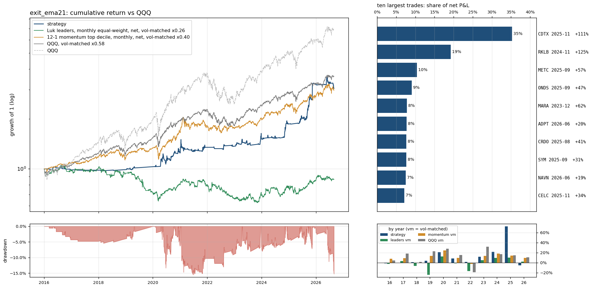

# `exit_ema21`: the trailing exit moved from the 9 EMA to the 21 EMA

Same as `full` (see `results/full/summary.md`) except: `exit_ema` 9 -> 21.

Sample 2016-01-04 to 2026-08-31, starting capital $100,000, code `cb16764382`.  
Entry `close_confirm` on the `ema9` pullback, 0.5% of the account at risk per trade, at most 10 positions and 280% gross, market filter `qqq_9>21`, slippage `nbbo`, stop fill `minute_open`, financing T-bill + 1.5%; idle cash earns the T-bill rate.
- note: 73 candidate stock-days were queried and had no eligible print (empty)
- note: 7844 of 324807 candidate stock-days were too thinly traded for close_confirm (min_bars / max_stale_minutes)

## Headline

| trades | win rate | avg win | avg loss | payoff | avg trade | profit/loss ratio | median hold win / loss (days) | avg % invested | longest underwater |
|---|---|---|---|---|---|---|---|---|---|
| 283 (27/yr) | 22% | 19.9% | -3.0% | 6.6 | 1.91% | 1.79 | 16 / 2 | 9% | 3.0 yr |

Avg % invested = capital utilisation: market value of open positions / net asset value, averaged over all trading days (the rest earns the T-bill rate); profit/loss ratio = gross profits / gross losses.

The strategy against passive benchmarks, all after costs, all on daily returns. 6-factor alpha is the intercept of daily excess returns regressed on the Fama-French factors (market, size, value, profitability, investment, momentum), times 252: the return per year the factor exposures do not explain; t uses Newey-West errors (5 lags); beta is the market loading.

|  | CAGR | vol | Sharpe | max drawdown | 6-factor alpha / yr (t) | market beta |
|---|---|---|---|---|---|---|
| **strategy** | 11.1% | 12.9% | 0.70 | -16% | 8.7% (2.1) | 0.05 |
| QQQ (total return) | 19.9% | 22.3% | 0.83 | -35% | 3.0% (1.9) | 1.11 |
| QQQ, vol-matched x0.58 | 12.8% | 12.9% | 0.83 | -21% | 1.8% (1.9) | 0.64 |
| 12-1 momentum top decile (87 names), net | 21.0% | 32.1% | 0.68 | -46% | 7.5% (1.7) | 1.17 |
| momentum, vol-matched x0.40 | 10.8% | 12.9% | 0.68 | -20% | 3.0% (1.7) | 0.47 |
| universe hold: Luk leader screen (16 names), net | -19.2% | 50.2% | -0.22 | -95% | -19.3% (-1.6) | 0.90 |
| universe hold, vol-matched x0.26 | -1.4% | 12.9% | -0.22 | -40% | -5.0% (-1.6) | 0.23 |

Passive benchmarks: equal-weight portfolios in the same liquidity pool (common stocks, price >= $5, 20-day dollar volume >= $50M), selected on the day before each month end, bought at the month end's close and held for the month, net of the same spread table plus commission. Vol-matched = a fraction k of the benchmark, chosen so the realised volatility equals the strategy's, with the rest in T-bills. Sharpe = annualised mean of daily returns in excess of the T-bill rate over their standard deviation.

## By year

| year | strategy | QQQ | QQQ vm | momentum vm | universe vm | trades | win | avg trade | max DD in year |
|---|---|---|---|---|---|---|---|---|---|
| 2016 | -1.4% | 7.1% | 4.4% | 7.8% | -2.7% | 9 | 11% | -0.65% | -4% |
| 2017 | -0.5% | 32.7% | 17.9% | 8.9% | 3.1% | 1 | 0% | -2.16% | -1% |
| 2018 | 0.8% | -0.1% | 1.6% | -0.2% | -6.2% | 3 | 0% | -3.08% | -1% |
| 2019 | 4.1% | 39.0% | 22.6% | 13.7% | -24.0% | 7 | 29% | 1.60% | -3% |
| 2020 | 20.9% | 48.6% | 28.1% | 24.4% | 12.3% | 66 | 26% | 1.63% | -13% |
| 2021 | 8.2% | 27.4% | 15.5% | 9.4% | -1.0% | 43 | 16% | 0.88% | -16% |
| 2022 | 1.5% | -32.6% | -18.9% | -2.1% | -16.5% | 13 | 8% | -0.27% | -4% |
| 2023 | 11.8% | 54.9% | 32.0% | 13.4% | 5.3% | 26 | 23% | 2.57% | -8% |
| 2024 | 21.8% | 25.6% | 17.0% | 18.0% | 9.5% | 24 | 25% | 3.42% | -5% |
| 2025 | 72.5% | 20.8% | 14.7% | 14.1% | 10.4% | 52 | 31% | 5.69% | -7% |
| 2026 | -5.2% | 17.0% | 10.9% | 9.8% | 2.0% | 39 | 13% | -1.04% | -15% |

## Factor attribution

Daily excess returns on the Fama-French 5 factors plus momentum (Newey-West t-statistics).

|  | days | 6-factor alpha / yr | R² | mkt | smb | hml | rmw | cma | umd |
|---|---|---|---|---|---|---|---|---|---|
| all days | 2680 | 8.7% (t 2.1) | 0.04 | 0.05 (3.4) | 0.14 (4.1) | 0.01 (0.5) | -0.14 (-3.6) | -0.02 (-0.3) | 0.04 (2.1) |
| invested days only | 832 | 22.8% (t 1.8) | 0.12 | 0.29 (4.9) | 0.32 (3.5) | 0.02 (0.3) | -0.33 (-3.5) | 0.01 (0.1) | 0.11 (2.2) |

## Largest trades

| ticker | entry | exit | exit reason | return | P&L | share of net P&L |
|---|---|---|---|---|---|---|
| CDTX | 2025-11-10 15:55 | 2025-12-02 09:30 | max_hold | +111% | $59,679 | 35% |
| RKLB | 2024-11-04 15:55 | 2024-11-25 09:30 | max_hold | +125% | $32,495 | 19% |
| METC | 2025-09-17 15:55 | 2025-10-08 09:30 | max_hold | +57% | $17,545 | 10% |
| ONDS | 2025-09-09 15:55 | 2025-09-30 09:30 | max_hold | +47% | $15,332 | 9% |
| MARA | 2023-12-12 15:55 | 2024-01-04 09:30 | max_hold | +62% | $13,172 | 8% |
| ADPT | 2026-06-18 15:55 | 2026-07-13 09:30 | max_hold | +20% | $13,106 | 8% |
| CRDO | 2025-08-25 15:55 | 2025-09-16 09:30 | max_hold | +41% | $12,925 | 8% |
| SYM | 2025-09-30 15:55 | 2025-10-21 09:30 | max_hold | +31% | $12,909 | 8% |
| NAVN | 2026-06-23 15:55 | 2026-07-15 09:30 | max_hold | +19% | $12,600 | 7% |
| CELC | 2025-11-07 15:55 | 2025-12-01 09:30 | max_hold | +34% | $12,031 | 7% |

Each year's largest trade against the year's net P&L: 2016 MDVN $2,960 / $-1,385; 2017 MDCO $-485 / $-485; 2018 RGNX $-518 / $-1,637; 2019 CVNA $2,583 / $1,624; 2020 TUP $6,815 / $21,157; 2021 M $11,025 / $10,049; 2022 SWAV $9,684 / $458; 2023 MARA $13,172 / $10,673; 2024 RKLB $32,495 / $25,121; 2025 CDTX $59,679 / $126,640; 2026 ADPT $13,106 / $-23,063.

## Risk

- Concentration: the top 5% of trades are 63% of gross wins; without the best 1% (2 trades) the average trade is 1.15% and the profit/loss ratio 1.36.
- Trade returns (net): p5 -4.7%, median -2.6%, p95 27.6%, best 109.9%, worst -14.4%.
- Gap-through stops: 29 trades (10.2%), $-44,764 of the $169,152 net; losses beyond twice the planned risk: 2; closed by delisting: 0; dividends credited $750; halted position-days: 0.
- Worst five: SYRE 2026-08-20 -14.4% (stop_gap); BTDR 2026-06-12 -7.5% (stop_gap); COHR 2026-06-30 -6.5% (stop_gap); AEVA 2026-06-22 -6.3% (stop_gap); GRAL 2025-05-19 -5.7% (stop).
- Block bootstrap (20-day blocks, 2000 draws): Sharpe 90% interval [0.30, 1.15], max drawdown median -15%, 5th percentile -24%.
- Capacity (position / 20-day dollar volume, sizing scaled to a fixed account): median 0.02% at $100,000; at $1M median 0.15%, 0% of trades above 1%.
- Worst day -6.1% (2026-06-05); days below -5%: 2; max simultaneous positions 10.

## Execution and costs

- Stop width median 2.8%; planned loss per trade 0.5% of the account.
- Entry half-spread by liquidity tier: $30-100M 0.056% (n=117, avg trade 1.97%); >$100M 0.036% (n=166, avg trade 1.87%).
- NBBO quotes (last quote before the fill minute) found for 100% of spread-paying fills (the rest use the tier table); exits with an exact minute: 100%.

| cost scenario | avg trade | profit/loss ratio | CAGR | Sharpe | max drawdown |
|---|---|---|---|---|---|
| zero slippage (commissions and fees only) | 2.09% | 1.95 | 12.0% | 0.77 | -15% |
| as specified (slippage=nbbo, stop fill=minute_open, margin T-bill+1.5%) | 1.91% | 1.79 | 11.1% | 0.70 | -16% |
| conservative (0.2% per side, stop slip 0.5%, 8% margin) | 1.38% | 1.48 | 8.3% | 0.50 | -18% |
