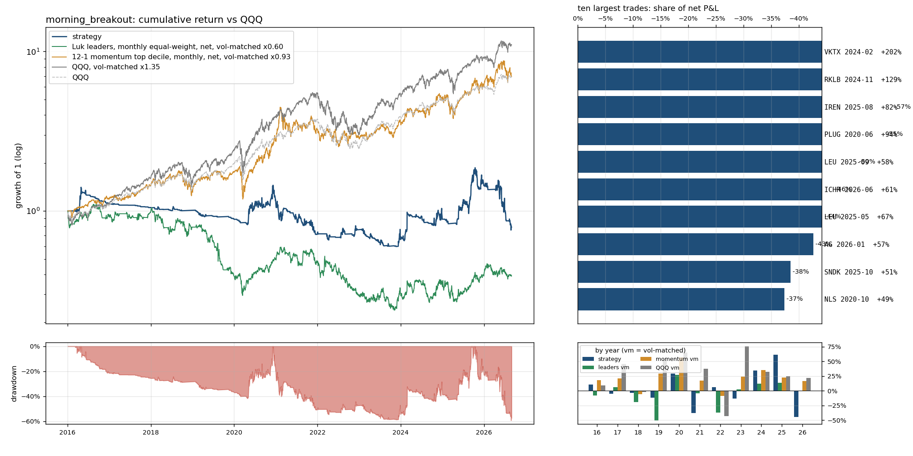

# `morning_breakout`: Luk's own entry, mechanised: a flush through the 9 EMA in the first hour, then the break of the previous 1-minute (first 15 min) or 5-minute bar high, no more than 3% above the low of day, losers closed at the end of the day; not in the default runs

Same as `full` (see `results/full/summary.md`) except: `entry` 'close_confirm' -> 'morning_breakout'; `min_stop_width` 0.02 -> 0.003; `cut_same_day` False -> True.

Sample 2016-01-04 to 2026-08-31, starting capital $100,000, code `cb16764382`.  
Entry `morning_breakout` on the `ema9` pullback, 0.5% of the account at risk per trade, at most 10 positions and 280% gross, market filter `qqq_9>21`, slippage `nbbo`, stop fill `minute_open`, financing T-bill + 1.5%; idle cash earns the T-bill rate.
- note: 73 candidate stock-days were queried and had no eligible print (empty)

## Headline

| trades | win rate | avg win | avg loss | payoff | avg trade | profit/loss ratio | median hold win / loss (days) | avg % invested | longest underwater |
|---|---|---|---|---|---|---|---|---|---|
| 1767 (166/yr) | 13% | 13.0% | -1.8% | 7.0 | 0.04% | 0.95 | 9 / 1 | 25% | 4.7 yr |

Avg % invested = capital utilisation: market value of open positions / net asset value, averaged over all trading days (the rest earns the T-bill rate); profit/loss ratio = gross profits / gross losses.

The strategy against passive benchmarks, all after costs, all on daily returns. 6-factor alpha is the intercept of daily excess returns regressed on the Fama-French factors (market, size, value, profitability, investment, momentum), times 252: the return per year the factor exposures do not explain; t uses Newey-West errors (5 lags); beta is the market loading.

|  | CAGR | vol | Sharpe | max drawdown | 6-factor alpha / yr (t) | market beta |
|---|---|---|---|---|---|---|
| **strategy** | -2.2% | 30.0% | -0.00 | -59% | -1.7% (-0.2) | 0.23 |
| QQQ (total return) | 19.9% | 22.3% | 0.83 | -35% | 3.0% (1.9) | 1.11 |
| QQQ, vol-matched x1.35 | 25.3% | 30.0% | 0.83 | -46% | 4.1% (1.9) | 1.50 |
| 12-1 momentum top decile (87 names), net | 21.0% | 32.1% | 0.68 | -46% | 7.5% (1.7) | 1.17 |
| momentum, vol-matched x0.93 | 20.1% | 30.0% | 0.68 | -44% | 7.0% (1.7) | 1.09 |
| universe hold: Luk leader screen (16 names), net | -19.2% | 50.2% | -0.22 | -95% | -19.3% (-1.6) | 0.90 |
| universe hold, vol-matched x0.60 | -8.5% | 30.0% | -0.22 | -78% | -11.6% (-1.6) | 0.54 |

Passive benchmarks: equal-weight portfolios in the same liquidity pool (common stocks, price >= $5, 20-day dollar volume >= $50M), selected on the day before each month end, bought at the month end's close and held for the month, net of the same spread table plus commission. Vol-matched = a fraction k of the benchmark, chosen so the realised volatility equals the strategy's, with the rest in T-bills. Sharpe = annualised mean of daily returns in excess of the T-bill rate over their standard deviation.

## By year

| year | strategy | QQQ | QQQ vm | momentum vm | universe vm | trades | win | avg trade | max DD in year |
|---|---|---|---|---|---|---|---|---|---|
| 2016 | 10.5% | 7.1% | 9.0% | 18.3% | -7.8% | 67 | 21% | 0.78% | -21% |
| 2017 | -5.3% | 32.7% | 46.0% | 21.0% | 6.1% | 16 | 6% | -1.18% | -6% |
| 2018 | -3.6% | -0.1% | -2.2% | -5.6% | -19.1% | 26 | 15% | -0.87% | -6% |
| 2019 | -11.9% | 39.0% | 53.5% | 29.1% | -50.5% | 45 | 7% | -1.26% | -12% |
| 2020 | 29.5% | 48.6% | 65.1% | 57.1% | 26.9% | 350 | 16% | 0.32% | -20% |
| 2021 | -37.7% | 27.4% | 37.5% | 17.4% | -4.5% | 288 | 10% | -0.49% | -38% |
| 2022 | 6.4% | -32.6% | -42.9% | -9.1% | -37.3% | 85 | 14% | 0.17% | -11% |
| 2023 | -13.2% | 54.9% | 75.9% | 24.2% | 2.6% | 130 | 12% | -0.34% | -22% |
| 2024 | 34.7% | 25.6% | 32.5% | 35.0% | 12.2% | 165 | 9% | 0.57% | -18% |
| 2025 | 61.2% | 20.8% | 25.1% | 22.3% | 13.9% | 300 | 15% | 0.83% | -27% |
| 2026 | -45.0% | 17.0% | 21.7% | 16.3% | 0.1% | 295 | 10% | -0.58% | -51% |

## Factor attribution

Daily excess returns on the Fama-French 5 factors plus momentum (Newey-West t-statistics).

|  | days | 6-factor alpha / yr | R² | mkt | smb | hml | rmw | cma | umd |
|---|---|---|---|---|---|---|---|---|---|
| all days | 2680 | -1.7% (t -0.2) | 0.09 | 0.23 (4.5) | 0.27 (3.7) | 0.12 (1.5) | -0.60 (-4.8) | -0.15 (-1.2) | 0.11 (1.8) |
| invested days only | 1246 | -6.5% (t -0.4) | 0.22 | 0.93 (9.1) | 0.34 (2.6) | 0.28 (2.0) | -1.09 (-5.4) | -0.14 (-0.6) | 0.19 (2.2) |

## Largest trades

| ticker | entry | exit | exit reason | return | P&L | share of net P&L |
|---|---|---|---|---|---|---|
| VKTX | 2024-02-05 10:26 | 2024-02-27 09:30 | max_hold | +202% | $33,219 | -93% |
| RKLB | 2024-11-04 09:38 | 2024-11-25 09:30 | max_hold | +129% | $26,724 | -75% |
| IREN | 2025-08-22 09:32 | 2025-09-15 09:30 | max_hold | +82% | $20,381 | -57% |
| PLUG | 2020-06-15 09:36 | 2020-07-07 09:30 | max_hold | +94% | $19,854 | -55% |
| LEU | 2025-09-08 10:24 | 2025-09-29 09:30 | max_hold | +58% | $18,077 | -50% |
| ICHR | 2026-06-10 09:32 | 2026-07-02 09:30 | max_hold | +61% | $16,538 | -46% |
| LEU | 2025-05-22 09:48 | 2025-06-13 09:30 | max_hold | +67% | $15,870 | -44% |
| AG | 2026-01-07 10:22 | 2026-01-29 09:30 | max_hold | +57% | $15,259 | -43% |
| SNDK | 2025-10-14 09:39 | 2025-11-04 09:30 | max_hold | +51% | $13,782 | -38% |
| NLS | 2020-10-02 09:31 | 2020-10-23 09:30 | max_hold | +49% | $13,392 | -37% |

Each year's largest trade against the year's net P&L: 2016 TCK $9,870 / $10,561; 2017 CENX $373 / $-5,862; 2018 TWTR $2,071 / $-6,235; 2019 CVNA $1,291 / $-14,244; 2020 PLUG $19,854 / $20,605; 2021 MRNA $9,870 / $-37,669; 2022 AXSM $7,307 / $3,435; 2023 MARA $12,975 / $-9,762; 2024 VKTX $33,219 / $15,831; 2025 IREN $20,381 / $53,293; 2026 ICHR $16,538 / $-65,753.

## Risk

- Concentration: the top 5% of trades are 82% of gross wins; without the best 1% (17 trades) the average trade is -0.56% and the profit/loss ratio 0.61.
- Trade returns (net): p5 -3.2%, median -1.6%, p95 9.5%, best 172.6%, worst -24.4%.
- Gap-through stops: 34 trades (1.9%), $-40,206 of the $-35,802 net; losses beyond twice the planned risk: 63; closed by delisting: 0; dividends credited $1,265; halted position-days: 0.
- Worst five: BBAI 2025-08-11 -24.4% (stop_gap); FUBO 2021-11-09 -9.8% (stop_gap); CYRN 2022-03-24 -9.8% (stop_gap); APLS 2023-12-12 -9.6% (stop_gap); SYRE 2026-08-18 -9.1% (stop_gap).
- Block bootstrap (20-day blocks, 2000 draws): Sharpe 90% interval [-0.46, 0.52], max drawdown median -66%, 5th percentile -88%.
- Capacity (position / 20-day dollar volume, sizing scaled to a fixed account): median 0.02% at $100,000; at $1M median 0.21%, 0% of trades above 1%.
- Worst day -19.1% (2026-06-05); days below -5%: 41; max simultaneous positions 10.

## Execution and costs

- Stop width median 1.8%; planned loss per trade 0.5% of the account.
- Entry half-spread by liquidity tier: $30-100M 0.224% (n=705, avg trade -0.07%); >$100M 0.119% (n=1062, avg trade 0.11%).
- NBBO quotes (last quote before the fill minute) found for 100% of spread-paying fills (the rest use the tier table); exits with an exact minute: 100%.

| cost scenario | avg trade | profit/loss ratio | CAGR | Sharpe | max drawdown |
|---|---|---|---|---|---|
| zero slippage (commissions and fees only) | 0.40% | 1.22 | 15.6% | 0.56 | -35% |
| as specified (slippage=nbbo, stop fill=minute_open, margin T-bill+1.5%) | 0.04% | 0.95 | -2.2% | -0.00 | -59% |
| conservative (0.2% per side, stop slip 0.5%, 8% margin) | -0.38% | 0.74 | -19.5% | -0.62 | -93% |
