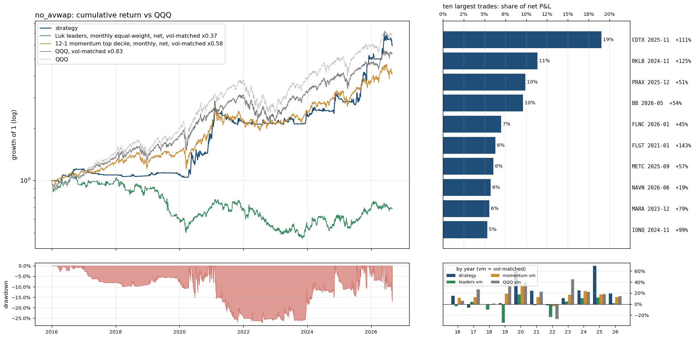

# `no_avwap`: the anchored-VWAP condition dropped from the universe

Same as `full` (see `results/full/summary.md`) except: `above_avwap` True -> False.

Sample 2016-01-04 to 2026-08-31, starting capital $100,000, code `cb16764382`.  
Entry `close_confirm` on the `ema9` pullback, 0.5% of the account at risk per trade, at most 10 positions and 280% gross, market filter `qqq_9>21`, slippage `nbbo`, stop fill `minute_open`, financing T-bill + 1.5%; idle cash earns the T-bill rate.
- note: 73 candidate stock-days were queried and had no eligible print (empty)
- note: 7844 of 324807 candidate stock-days were too thinly traded for close_confirm (min_bars / max_stale_minutes)

## Headline

| trades | win rate | avg win | avg loss | payoff | avg trade | profit/loss ratio | median hold win / loss (days) | avg % invested | longest underwater |
|---|---|---|---|---|---|---|---|---|---|
| 787 (74/yr) | 26% | 14.0% | -3.0% | 4.6 | 1.46% | 1.55 | 10 / 2 | 19% | 3.8 yr |

Avg % invested = capital utilisation: market value of open positions / net asset value, averaged over all trading days (the rest earns the T-bill rate); profit/loss ratio = gross profits / gross losses.

The strategy against passive benchmarks, all after costs, all on daily returns. 6-factor alpha is the intercept of daily excess returns regressed on the Fama-French factors (market, size, value, profitability, investment, momentum), times 252: the return per year the factor exposures do not explain; t uses Newey-West errors (5 lags); beta is the market loading.

|  | CAGR | vol | Sharpe | max drawdown | 6-factor alpha / yr (t) | market beta |
|---|---|---|---|---|---|---|
| **strategy** | 18.2% | 18.5% | 0.87 | -27% | 15.7% (2.6) | 0.09 |
| QQQ (total return) | 19.9% | 22.3% | 0.83 | -35% | 3.0% (1.9) | 1.11 |
| QQQ, vol-matched x0.83 | 17.2% | 18.5% | 0.83 | -30% | 2.5% (1.9) | 0.92 |
| 12-1 momentum top decile (87 names), net | 21.0% | 32.1% | 0.68 | -46% | 7.5% (1.7) | 1.17 |
| momentum, vol-matched x0.58 | 14.1% | 18.5% | 0.68 | -28% | 4.3% (1.7) | 0.67 |
| universe hold: Luk leader screen (16 names), net | -19.2% | 50.2% | -0.22 | -95% | -19.3% (-1.6) | 0.90 |
| universe hold, vol-matched x0.37 | -3.4% | 18.5% | -0.22 | -56% | -7.1% (-1.6) | 0.33 |

Passive benchmarks: equal-weight portfolios in the same liquidity pool (common stocks, price >= $5, 20-day dollar volume >= $50M), selected on the day before each month end, bought at the month end's close and held for the month, net of the same spread table plus commission. Vol-matched = a fraction k of the benchmark, chosen so the realised volatility equals the strategy's, with the rest in T-bills. Sharpe = annualised mean of daily returns in excess of the T-bill rate over their standard deviation.

## By year

| year | strategy | QQQ | QQQ vm | momentum vm | universe vm | trades | win | avg trade | max DD in year |
|---|---|---|---|---|---|---|---|---|---|
| 2016 | 15.1% | 7.1% | 6.1% | 11.2% | -4.1% | 22 | 32% | 3.54% | -3% |
| 2017 | -6.5% | 32.7% | 26.5% | 12.8% | 4.3% | 15 | 0% | -2.44% | -8% |
| 2018 | -1.1% | -0.1% | 0.7% | -1.7% | -10.3% | 14 | 14% | -1.38% | -3% |
| 2019 | 1.5% | 39.0% | 32.2% | 18.7% | -33.7% | 21 | 33% | -0.12% | -3% |
| 2020 | 61.8% | 48.6% | 40.4% | 35.1% | 17.2% | 191 | 29% | 1.83% | -15% |
| 2021 | 24.5% | 27.4% | 22.6% | 12.7% | -1.9% | 121 | 26% | 1.40% | -27% |
| 2022 | -2.1% | -32.6% | -27.2% | -4.1% | -23.7% | 31 | 23% | -0.60% | -6% |
| 2023 | 10.5% | 54.9% | 45.3% | 17.0% | 4.8% | 58 | 26% | 1.40% | -8% |
| 2024 | 24.7% | 25.6% | 22.1% | 23.7% | 10.8% | 93 | 25% | 1.72% | -8% |
| 2025 | 69.6% | 20.8% | 18.4% | 17.3% | 12.0% | 129 | 28% | 2.22% | -12% |
| 2026 | 19.1% | 17.0% | 14.6% | 12.4% | 1.6% | 92 | 26% | 1.13% | -17% |

## Factor attribution

Daily excess returns on the Fama-French 5 factors plus momentum (Newey-West t-statistics).

|  | days | 6-factor alpha / yr | R² | mkt | smb | hml | rmw | cma | umd |
|---|---|---|---|---|---|---|---|---|---|
| all days | 2680 | 15.7% (t 2.6) | 0.08 | 0.09 (4.1) | 0.21 (4.3) | -0.02 (-0.4) | -0.34 (-5.5) | 0.06 (0.9) | 0.08 (3.0) |
| invested days only | 1262 | 24.6% (t 2.0) | 0.16 | 0.39 (6.5) | 0.34 (3.8) | -0.04 (-0.5) | -0.64 (-6.2) | 0.18 (1.3) | 0.15 (3.1) |

## Largest trades

| ticker | entry | exit | exit reason | return | P&L | share of net P&L |
|---|---|---|---|---|---|---|
| CDTX | 2025-11-10 15:55 | 2025-12-02 09:30 | max_hold | +111% | $85,503 | 19% |
| RKLB | 2024-11-04 15:55 | 2024-11-25 09:30 | max_hold | +125% | $50,985 | 11% |
| PRAX | 2025-12-03 15:55 | 2025-12-24 09:30 | max_hold | +51% | $44,480 | 10% |
| BB | 2026-05-15 15:55 | 2026-06-08 09:30 | max_hold | +54% | $43,107 | 10% |
| FLNC | 2026-01-08 15:55 | 2026-01-30 09:30 | max_hold | +45% | $31,445 | 7% |
| FLGT | 2021-01-22 15:55 | 2021-02-12 09:30 | max_hold | +143% | $28,316 | 6% |
| METC | 2025-09-17 15:55 | 2025-10-08 09:30 | max_hold | +57% | $27,257 | 6% |
| NAVN | 2026-06-23 15:55 | 2026-07-15 09:30 | max_hold | +19% | $25,790 | 6% |
| MARA | 2023-12-12 15:55 | 2024-01-02 09:30 | close_below_ema9 | +79% | $25,087 | 6% |
| IONQ | 2024-11-05 15:55 | 2024-11-26 09:30 | max_hold | +99% | $23,970 | 5% |

Each year's largest trade against the year's net P&L: 2016 FCX $7,324 / $15,086; 2017 KITE $-154 / $-7,495; 2018 CVNA $1,956 / $-3,695; 2019 SAGE $2,751 / $-805; 2020 DNLI $16,128 / $70,149; 2021 FLGT $28,316 / $37,598; 2022 SWAV $15,409 / $-5,786; 2023 MARA $25,087 / $20,262; 2024 RKLB $50,985 / $40,863; 2025 CDTX $85,503 / $191,790; 2026 BB $43,107 / $91,203.

## Risk

- Concentration: the top 5% of trades are 67% of gross wins; without the best 1% (7 trades) the average trade is 0.80% and the profit/loss ratio 1.17.
- Trade returns (net): p5 -4.9%, median -2.5%, p95 21.8%, best 123.7%, worst -14.4%.
- Gap-through stops: 53 trades (6.7%), $-132,176 of the $449,169 net; losses beyond twice the planned risk: 12; closed by delisting: 0; dividends credited $3,073; halted position-days: 0.
- Worst five: SYRE 2026-08-20 -14.4% (stop_gap); OKLO 2024-11-14 -12.4% (stop_gap); SHLS 2025-10-31 -12.2% (close_below_ema9); AMPX 2026-05-05 -10.1% (stop_gap); ITCI 2020-01-06 -10.0% (stop_gap).
- Block bootstrap (20-day blocks, 2000 draws): Sharpe 90% interval [0.43, 1.37], max drawdown median -23%, 5th percentile -35%.
- Capacity (position / 20-day dollar volume, sizing scaled to a fixed account): median 0.01% at $100,000; at $1M median 0.15%, 0% of trades above 1%.
- Worst day -11.1% (2026-06-05); days below -5%: 7; max simultaneous positions 10.

## Execution and costs

- Stop width median 2.9%; planned loss per trade 0.5% of the account.
- Entry half-spread by liquidity tier: $30-100M 0.060% (n=344, avg trade 0.95%); >$100M 0.044% (n=443, avg trade 1.86%).
- NBBO quotes (last quote before the fill minute) found for 100% of spread-paying fills (the rest use the tier table); exits with an exact minute: 100%.

| cost scenario | avg trade | profit/loss ratio | CAGR | Sharpe | max drawdown |
|---|---|---|---|---|---|
| zero slippage (commissions and fees only) | 1.64% | 1.69 | 21.0% | 1.00 | -25% |
| as specified (slippage=nbbo, stop fill=minute_open, margin T-bill+1.5%) | 1.46% | 1.55 | 18.2% | 0.87 | -27% |
| conservative (0.2% per side, stop slip 0.5%, 8% margin) | 0.98% | 1.28 | 10.9% | 0.52 | -36% |
