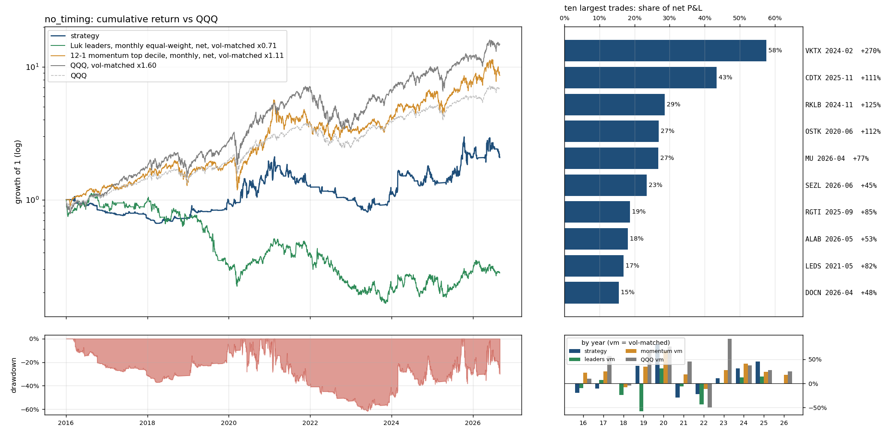

# `no_timing`: the rule without the pullback timing: a strong stock is bought at 15:55 on any day it trades within half an ADR of its 9 EMA by 15:54, with no touch, reclaim or strong-close requirement; stops, sizing and exits as in full. If this works, the edge is the universe, not the timing

Same as `full` (see `results/full/summary.md`) except: `touch_tolerance_adr` 0.0 -> 0.5; `require_green` True -> False; `min_close_position` 0.4 -> 0.0.

Sample 2016-01-04 to 2026-08-31, starting capital $100,000, code `2dec7acf90`.  
Entry `close_confirm` on the `ema9` pullback, 0.5% of the account at risk per trade, at most 10 positions and 280% gross, market filter `qqq_9>21`, slippage `nbbo`, stop fill `minute_open`, financing T-bill + 1.5%; idle cash earns the T-bill rate.
- note: 73 candidate stock-days were queried and had no eligible print (empty)
- note: 7844 of 324807 candidate stock-days were too thinly traded for close_confirm (min_bars / max_stale_minutes)

## Headline

| trades | win rate | avg win | avg loss | payoff | avg trade | profit/loss ratio | median hold win / loss (days) | avg % invested | longest underwater |
|---|---|---|---|---|---|---|---|---|---|
| 2541 (239/yr) | 29% | 8.3% | -3.0% | 2.8 | 0.27% | 1.07 | 2 / 2 | 48% | 4.6 yr |

Avg % invested = capital utilisation: market value of open positions / net asset value, averaged over all trading days (the rest earns the T-bill rate); profit/loss ratio = gross profits / gross losses.

The strategy against passive benchmarks, all after costs, all on daily returns. 6-factor alpha is the intercept of daily excess returns regressed on the Fama-French factors (market, size, value, profitability, investment, momentum), times 252: the return per year the factor exposures do not explain; t uses Newey-West errors (5 lags); beta is the market loading.

|  | CAGR | vol | Sharpe | max drawdown | 6-factor alpha / yr (t) | market beta |
|---|---|---|---|---|---|---|
| **strategy** | 7.1% | 35.7% | 0.30 | -62% | 8.9% (0.8) | 0.29 |
| QQQ (total return) | 19.9% | 22.3% | 0.83 | -35% | 3.0% (1.9) | 1.11 |
| QQQ, vol-matched x1.60 | 28.8% | 35.7% | 0.83 | -53% | 4.9% (1.9) | 1.78 |
| 12-1 momentum top decile (87 names), net | 21.0% | 32.1% | 0.68 | -46% | 7.5% (1.7) | 1.17 |
| momentum, vol-matched x1.11 | 22.5% | 35.7% | 0.68 | -50% | 8.3% (1.7) | 1.30 |
| universe hold: Luk leader screen (16 names), net | -19.2% | 50.2% | -0.22 | -95% | -19.3% (-1.6) | 0.90 |
| universe hold, vol-matched x0.71 | -11.2% | 35.7% | -0.22 | -85% | -13.7% (-1.6) | 0.64 |

Passive benchmarks: equal-weight portfolios in the same liquidity pool (common stocks, price >= $5, 20-day dollar volume >= $50M), selected on the day before each month end, bought at the month end's close and held for the month, net of the same spread table plus commission. Vol-matched = a fraction k of the benchmark, chosen so the realised volatility equals the strategy's, with the rest in T-bills. Sharpe = annualised mean of daily returns in excess of the T-bill rate over their standard deviation.

## By year

| year | strategy | QQQ | QQQ vm | momentum vm | universe vm | trades | win | avg trade | max DD in year |
|---|---|---|---|---|---|---|---|---|---|
| 2016 | -19.4% | 7.1% | 10.2% | 21.8% | -9.8% | 97 | 28% | -1.13% | -25% |
| 2017 | -10.3% | 32.7% | 56.4% | 25.0% | 6.8% | 38 | 21% | -1.56% | -11% |
| 2018 | 0.3% | -0.1% | -4.1% | -7.7% | -23.6% | 46 | 22% | -0.16% | -9% |
| 2019 | 36.7% | 39.0% | 64.7% | 34.3% | -57.4% | 67 | 34% | 1.74% | -12% |
| 2020 | 81.6% | 48.6% | 76.4% | 67.5% | 31.4% | 420 | 30% | 0.77% | -28% |
| 2021 | -29.3% | 27.4% | 45.0% | 18.8% | -6.1% | 414 | 28% | -0.12% | -40% |
| 2022 | -22.2% | -32.6% | -49.8% | -11.9% | -43.4% | 114 | 22% | -1.19% | -24% |
| 2023 | 10.8% | 54.9% | 92.5% | 27.6% | 1.0% | 218 | 28% | 0.66% | -22% |
| 2024 | 30.9% | 25.6% | 37.5% | 40.5% | 12.2% | 343 | 27% | 0.37% | -24% |
| 2025 | 45.5% | 20.8% | 27.9% | 23.9% | 14.2% | 482 | 33% | 0.71% | -38% |
| 2026 | -0.6% | 17.0% | 25.0% | 17.4% | -0.9% | 302 | 26% | -0.04% | -29% |

## Factor attribution

Daily excess returns on the Fama-French 5 factors plus momentum (Newey-West t-statistics).

|  | days | 6-factor alpha / yr | R² | mkt | smb | hml | rmw | cma | umd |
|---|---|---|---|---|---|---|---|---|---|
| all days | 2680 | 8.9% (t 0.8) | 0.13 | 0.29 (4.4) | 0.51 (5.3) | 0.03 (0.3) | -0.80 (-6.3) | 0.02 (0.1) | 0.20 (2.7) |
| invested days only | 1717 | 9.0% (t 0.6) | 0.23 | 0.82 (6.2) | 0.68 (4.6) | 0.02 (0.1) | -1.16 (-6.5) | 0.09 (0.4) | 0.29 (2.9) |

## Largest trades

| ticker | entry | exit | exit reason | return | P&L | share of net P&L |
|---|---|---|---|---|---|---|
| VKTX | 2024-02-07 15:55 | 2024-02-29 09:30 | max_hold | +270% | $57,432 | 58% |
| CDTX | 2025-11-10 15:55 | 2025-12-02 09:30 | max_hold | +111% | $43,269 | 43% |
| RKLB | 2024-11-04 15:55 | 2024-11-25 09:30 | max_hold | +125% | $28,508 | 29% |
| OSTK | 2020-06-16 15:55 | 2020-07-08 09:30 | max_hold | +112% | $26,798 | 27% |
| MU | 2026-04-20 15:55 | 2026-05-11 09:30 | max_hold | +77% | $26,705 | 27% |
| SEZL | 2026-06-10 15:55 | 2026-07-02 09:30 | max_hold | +45% | $23,364 | 23% |
| RGTI | 2025-09-11 15:55 | 2025-10-02 09:30 | max_hold | +85% | $18,685 | 19% |
| ALAB | 2026-05-18 15:55 | 2026-06-08 09:30 | close_below_ema9 | +53% | $18,022 | 18% |
| LEDS | 2021-05-27 15:55 | 2021-06-16 09:30 | close_below_ema9 | +82% | $16,851 | 17% |
| DOCN | 2026-04-30 15:55 | 2026-05-19 09:30 | close_below_ema9 | +48% | $15,443 | 15% |

Each year's largest trade against the year's net P&L: 2016 DDD $3,504 / $-19,885; 2017 ALNY $2,815 / $-7,667; 2018 TNDM $3,631 / $-1,511; 2019 AXSM $12,804 / $19,088; 2020 OSTK $26,798 / $73,816; 2021 LEDS $16,851 / $-40,430; 2022 SWAV $8,312 / $-27,931; 2023 MARA $10,496 / $10,392; 2024 VKTX $57,432 / $26,781; 2025 CDTX $43,269 / $74,975; 2026 MU $26,705 / $-7,936.

## Risk

- Concentration: the top 5% of trades are 68% of gross wins; without the best 1% (25 trades) the average trade is -0.36% and the profit/loss ratio 0.77.
- Trade returns (net): p5 -5.0%, median -2.3%, p95 13.0%, best 230.5%, worst -32.4%.
- Gap-through stops: 182 trades (7.2%), $-299,506 of the $99,692 net; losses beyond twice the planned risk: 89; closed by delisting: 0; dividends credited $3,156; halted position-days: 0.
- Worst five: DPW 2017-12-21 -32.4% (stop_gap); SMMT 2026-04-30 -25.8% (close_below_ema9); CLVS 2016-10-06 -23.2% (stop_gap); NVTS 2025-08-04 -22.8% (stop_gap); TSSI 2025-08-06 -20.7% (stop_gap).
- Block bootstrap (20-day blocks, 2000 draws): Sharpe 90% interval [-0.10, 0.78], max drawdown median -59%, 5th percentile -81%.
- Capacity (position / 20-day dollar volume, sizing scaled to a fixed account): median 0.01% at $100,000; at $1M median 0.15%, 0% of trades above 1%.
- Worst day -19.3% (2020-06-11); days below -5%: 50; max simultaneous positions 10.

## Execution and costs

- Stop width median 2.8%; planned loss per trade 0.5% of the account.
- Entry half-spread by liquidity tier: $30-100M 0.061% (n=1060, avg trade 0.41%); >$100M 0.043% (n=1481, avg trade 0.17%).
- NBBO quotes (last quote before the fill minute) found for 100% of spread-paying fills (the rest use the tier table); exits with an exact minute: 100%.

| cost scenario | avg trade | profit/loss ratio | CAGR | Sharpe | max drawdown |
|---|---|---|---|---|---|
| zero slippage (commissions and fees only) | 0.44% | 1.16 | 16.3% | 0.54 | -55% |
| as specified (slippage=nbbo, stop fill=minute_open, margin T-bill+1.5%) | 0.27% | 1.07 | 7.1% | 0.30 | -62% |
| conservative (0.2% per side, stop slip 0.5%, 8% margin) | -0.18% | 0.87 | -13.0% | -0.26 | -79% |
