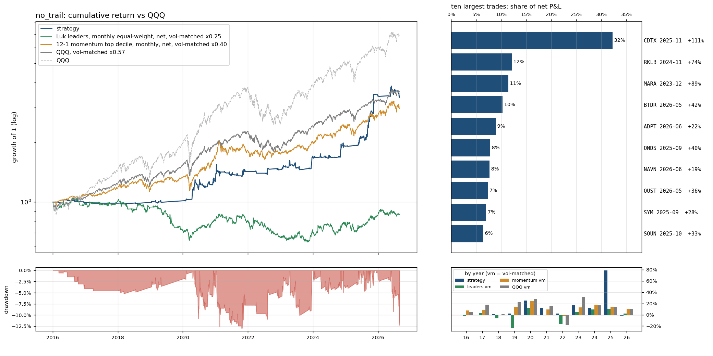

# `no_trail`: the rule without the trend-following exit: the same entries and stops, no partial, no EMA exit, a fixed 10-day hold

Same as `full` (see `results/full/summary.md`) except: `exit_ema` 9 -> None; `partial_at_r` 3.0 -> None; `max_hold_days` 15 -> 10.

Sample 2016-01-04 to 2026-08-31, starting capital $100,000, code `cb16764382`.  
Entry `close_confirm` on the `ema9` pullback, 0.5% of the account at risk per trade, at most 10 positions and 280% gross, market filter `qqq_9>21`, slippage `nbbo`, stop fill `minute_open`, financing T-bill + 1.5%; idle cash earns the T-bill rate.
- note: 73 candidate stock-days were queried and had no eligible print (empty)
- note: 7844 of 324807 candidate stock-days were too thinly traded for close_confirm (min_bars / max_stale_minutes)

## Headline

| trades | win rate | avg win | avg loss | payoff | avg trade | profit/loss ratio | median hold win / loss (days) | avg % invested | longest underwater |
|---|---|---|---|---|---|---|---|---|---|
| 285 (27/yr) | 21% | 22.4% | -3.3% | 6.8 | 2.10% | 1.79 | 11 / 2 | 8% | 3.8 yr |

Avg % invested = capital utilisation: market value of open positions / net asset value, averaged over all trading days (the rest earns the T-bill rate); profit/loss ratio = gross profits / gross losses.

The strategy against passive benchmarks, all after costs, all on daily returns. 6-factor alpha is the intercept of daily excess returns regressed on the Fama-French factors (market, size, value, profitability, investment, momentum), times 252: the return per year the factor exposures do not explain; t uses Newey-West errors (5 lags); beta is the market loading.

|  | CAGR | vol | Sharpe | max drawdown | 6-factor alpha / yr (t) | market beta |
|---|---|---|---|---|---|---|
| **strategy** | 12.1% | 12.8% | 0.78 | -13% | 9.6% (2.3) | 0.05 |
| QQQ (total return) | 19.9% | 22.3% | 0.83 | -35% | 3.0% (1.9) | 1.11 |
| QQQ, vol-matched x0.57 | 12.8% | 12.8% | 0.83 | -21% | 1.7% (1.9) | 0.64 |
| 12-1 momentum top decile (87 names), net | 21.0% | 32.1% | 0.68 | -46% | 7.5% (1.7) | 1.17 |
| momentum, vol-matched x0.40 | 10.7% | 12.8% | 0.68 | -20% | 3.0% (1.7) | 0.47 |
| universe hold: Luk leader screen (16 names), net | -19.2% | 50.2% | -0.22 | -95% | -19.3% (-1.6) | 0.90 |
| universe hold, vol-matched x0.25 | -1.3% | 12.8% | -0.22 | -40% | -4.9% (-1.6) | 0.23 |

Passive benchmarks: equal-weight portfolios in the same liquidity pool (common stocks, price >= $5, 20-day dollar volume >= $50M), selected on the day before each month end, bought at the month end's close and held for the month, net of the same spread table plus commission. Vol-matched = a fraction k of the benchmark, chosen so the realised volatility equals the strategy's, with the rest in T-bills. Sharpe = annualised mean of daily returns in excess of the T-bill rate over their standard deviation.

## By year

| year | strategy | QQQ | QQQ vm | momentum vm | universe vm | trades | win | avg trade | max DD in year |
|---|---|---|---|---|---|---|---|---|---|
| 2016 | -0.8% | 7.1% | 4.3% | 7.7% | -2.6% | 9 | 11% | -0.30% | -4% |
| 2017 | -0.5% | 32.7% | 17.8% | 8.8% | 3.1% | 1 | 0% | -2.33% | -1% |
| 2018 | 0.8% | -0.1% | 1.7% | -0.2% | -6.1% | 3 | 0% | -3.08% | -1% |
| 2019 | 1.9% | 39.0% | 22.5% | 13.6% | -23.8% | 7 | 29% | -0.29% | -3% |
| 2020 | 25.4% | 48.6% | 27.9% | 24.2% | 12.2% | 66 | 23% | 2.28% | -11% |
| 2021 | 12.2% | 27.4% | 15.4% | 9.3% | -1.0% | 43 | 21% | 0.68% | -13% |
| 2022 | 2.0% | -32.6% | -18.8% | -2.1% | -16.4% | 13 | 8% | -0.10% | -4% |
| 2023 | 16.9% | 54.9% | 31.8% | 13.4% | 5.3% | 26 | 23% | 3.84% | -10% |
| 2024 | 12.3% | 25.6% | 16.9% | 17.9% | 9.5% | 25 | 20% | 1.31% | -5% |
| 2025 | 78.8% | 20.8% | 14.6% | 14.1% | 10.4% | 52 | 31% | 6.07% | -5% |
| 2026 | -1.5% | 17.0% | 10.9% | 9.8% | 2.0% | 40 | 12% | -0.33% | -12% |

## Factor attribution

Daily excess returns on the Fama-French 5 factors plus momentum (Newey-West t-statistics).

|  | days | 6-factor alpha / yr | R² | mkt | smb | hml | rmw | cma | umd |
|---|---|---|---|---|---|---|---|---|---|
| all days | 2680 | 9.6% (t 2.3) | 0.03 | 0.05 (3.5) | 0.13 (3.9) | 0.02 (0.6) | -0.10 (-3.2) | -0.01 (-0.2) | 0.02 (1.1) |
| invested days only | 755 | 26.3% (t 2.0) | 0.12 | 0.33 (5.5) | 0.33 (3.3) | 0.02 (0.3) | -0.28 (-3.1) | 0.01 (0.1) | 0.08 (1.5) |

## Largest trades

| ticker | entry | exit | exit reason | return | P&L | share of net P&L |
|---|---|---|---|---|---|---|
| CDTX | 2025-11-10 15:55 | 2025-11-24 09:30 | max_hold | +111% | $63,915 | 32% |
| RKLB | 2024-11-04 15:55 | 2024-11-18 09:30 | max_hold | +74% | $23,983 | 12% |
| MARA | 2023-12-12 15:55 | 2023-12-27 09:30 | max_hold | +89% | $22,667 | 11% |
| BTDR | 2026-05-20 15:55 | 2026-06-04 09:30 | max_hold | +42% | $20,355 | 10% |
| ADPT | 2026-06-18 15:55 | 2026-07-06 09:30 | max_hold | +22% | $17,599 | 9% |
| ONDS | 2025-09-09 15:55 | 2025-09-23 09:30 | max_hold | +40% | $15,431 | 8% |
| NAVN | 2026-06-23 15:55 | 2026-07-08 09:30 | max_hold | +19% | $15,159 | 8% |
| OUST | 2026-05-20 15:55 | 2026-06-04 09:30 | max_hold | +36% | $14,450 | 7% |
| SYM | 2025-09-30 15:55 | 2025-10-14 09:30 | max_hold | +28% | $13,870 | 7% |
| SOUN | 2025-10-01 15:55 | 2025-10-15 09:30 | max_hold | +33% | $12,798 | 6% |

Each year's largest trade against the year's net P&L: 2016 MDVN $3,580 / $-789; 2017 MDCO $-525 / $-525; 2018 RGNX $-521 / $-1,645; 2019 CVNA $1,132 / $-549; 2020 MRNA $8,768 / $30,644; 2021 AAL $9,236 / $10,014; 2022 SWAV $11,294 / $1,113; 2023 MARA $22,667 / $17,832; 2024 RKLB $23,983 / $12,937; 2025 CDTX $63,915 / $141,119; 2026 BTDR $20,355 / $-11,925.

## Risk

- Concentration: the top 5% of trades are 59% of gross wins; without the best 1% (2 trades) the average trade is 1.46% and the profit/loss ratio 1.44.
- Trade returns (net): p5 -4.7%, median -2.8%, p95 27.5%, best 110.3%, worst -14.4%.
- Gap-through stops: 31 trades (10.9%), $-51,792 of the $198,226 net; losses beyond twice the planned risk: 3; closed by delisting: 0; dividends credited $68; halted position-days: 0.
- Worst five: SYRE 2026-08-20 -14.4% (stop_gap); BTDR 2026-06-12 -7.5% (stop_gap); CVAC 2021-06-03 -6.7% (stop_gap); COHR 2026-06-30 -6.5% (stop_gap); AEVA 2026-06-22 -6.3% (stop_gap).
- Block bootstrap (20-day blocks, 2000 draws): Sharpe 90% interval [0.38, 1.24], max drawdown median -14%, 5th percentile -22%.
- Capacity (position / 20-day dollar volume, sizing scaled to a fixed account): median 0.02% at $100,000; at $1M median 0.15%, 0% of trades above 1%.
- Worst day -4.6% (2021-01-15); days below -5%: 0; max simultaneous positions 10.

## Execution and costs

- Stop width median 2.8%; planned loss per trade 0.5% of the account.
- Entry half-spread by liquidity tier: $30-100M 0.056% (n=118, avg trade 1.69%); >$100M 0.036% (n=167, avg trade 2.38%).
- NBBO quotes (last quote before the fill minute) found for 100% of spread-paying fills (the rest use the tier table); exits with an exact minute: 100%.

| cost scenario | avg trade | profit/loss ratio | CAGR | Sharpe | max drawdown |
|---|---|---|---|---|---|
| zero slippage (commissions and fees only) | 2.28% | 1.94 | 13.1% | 0.85 | -12% |
| as specified (slippage=nbbo, stop fill=minute_open, margin T-bill+1.5%) | 2.10% | 1.79 | 12.1% | 0.78 | -13% |
| conservative (0.2% per side, stop slip 0.5%, 8% margin) | 1.55% | 1.50 | 9.2% | 0.56 | -16% |
