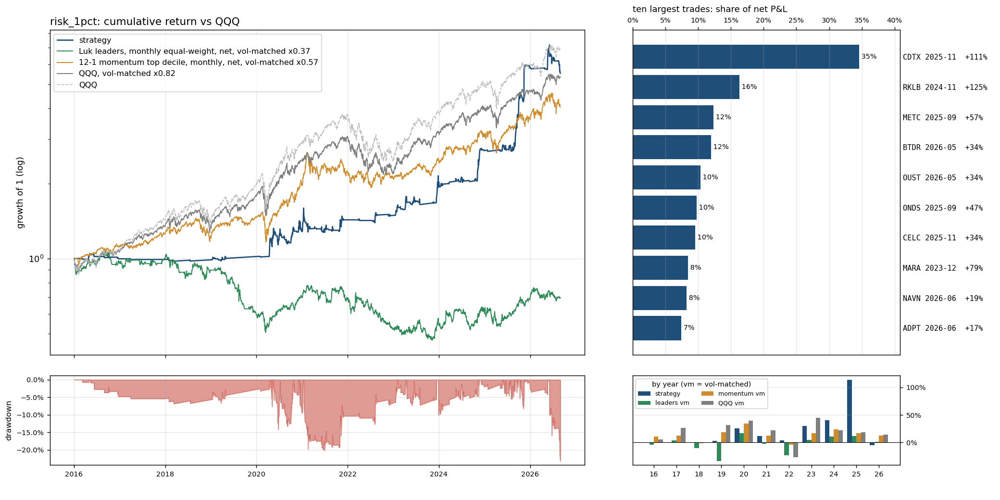

# `risk_1pct`: the same trades with 1% of the account at risk per trade instead of 0.5%

Same as `full` (see `results/full/summary.md`) except: `risk_per_trade` 0.005 -> 0.01.

Sample 2016-01-04 to 2026-08-31, starting capital $100,000, code `cb16764382`.  
Entry `close_confirm` on the `ema9` pullback, 1.0% of the account at risk per trade, at most 10 positions and 280% gross, market filter `qqq_9>21`, slippage `nbbo`, stop fill `minute_open`, financing T-bill + 1.5%; idle cash earns the T-bill rate.
- note: 73 candidate stock-days were queried and had no eligible print (empty)
- note: 7844 of 324807 candidate stock-days were too thinly traded for close_confirm (min_bars / max_stale_minutes)

## Headline

| trades | win rate | avg win | avg loss | payoff | avg trade | profit/loss ratio | median hold win / loss (days) | avg % invested | longest underwater |
|---|---|---|---|---|---|---|---|---|---|
| 287 (27/yr) | 29% | 14.3% | -2.9% | 4.8 | 2.10% | 1.87 | 10 / 2 | 12% | 3.9 yr |

Avg % invested = capital utilisation: market value of open positions / net asset value, averaged over all trading days (the rest earns the T-bill rate); profit/loss ratio = gross profits / gross losses.

The strategy against passive benchmarks, all after costs, all on daily returns. 6-factor alpha is the intercept of daily excess returns regressed on the Fama-French factors (market, size, value, profitability, investment, momentum), times 252: the return per year the factor exposures do not explain; t uses Newey-West errors (5 lags); beta is the market loading.

|  | CAGR | vol | Sharpe | max drawdown | 6-factor alpha / yr (t) | market beta |
|---|---|---|---|---|---|---|
| **strategy** | 17.4% | 18.3% | 0.84 | -23% | 15.0% (2.4) | 0.07 |
| QQQ (total return) | 19.9% | 22.3% | 0.83 | -35% | 3.0% (1.9) | 1.11 |
| QQQ, vol-matched x0.82 | 17.0% | 18.3% | 0.83 | -29% | 2.5% (1.9) | 0.91 |
| 12-1 momentum top decile (87 names), net | 21.0% | 32.1% | 0.68 | -46% | 7.5% (1.7) | 1.17 |
| momentum, vol-matched x0.57 | 14.0% | 18.3% | 0.68 | -28% | 4.3% (1.7) | 0.67 |
| universe hold: Luk leader screen (16 names), net | -19.2% | 50.2% | -0.22 | -95% | -19.3% (-1.6) | 0.90 |
| universe hold, vol-matched x0.37 | -3.4% | 18.3% | -0.22 | -56% | -7.1% (-1.6) | 0.33 |

Passive benchmarks: equal-weight portfolios in the same liquidity pool (common stocks, price >= $5, 20-day dollar volume >= $50M), selected on the day before each month end, bought at the month end's close and held for the month, net of the same spread table plus commission. Vol-matched = a fraction k of the benchmark, chosen so the realised volatility equals the strategy's, with the rest in T-bills. Sharpe = annualised mean of daily returns in excess of the T-bill rate over their standard deviation.

## By year

| year | strategy | QQQ | QQQ vm | momentum vm | universe vm | trades | win | avg trade | max DD in year |
|---|---|---|---|---|---|---|---|---|---|
| 2016 | -0.3% | 7.1% | 6.0% | 11.1% | -4.1% | 9 | 22% | -0.05% | -5% |
| 2017 | -0.6% | 32.7% | 26.3% | 12.7% | 4.2% | 1 | 0% | -2.16% | -1% |
| 2018 | -0.3% | -0.1% | 0.7% | -1.7% | -10.2% | 3 | 0% | -3.08% | -2% |
| 2019 | 3.1% | 39.0% | 31.9% | 18.5% | -33.4% | 7 | 43% | 0.30% | -3% |
| 2020 | 25.8% | 48.6% | 40.0% | 34.8% | 17.1% | 68 | 28% | 1.40% | -14% |
| 2021 | 11.5% | 27.4% | 22.4% | 12.6% | -1.9% | 43 | 30% | 0.79% | -20% |
| 2022 | 4.2% | -32.6% | -27.0% | -4.1% | -23.5% | 13 | 31% | 0.74% | -3% |
| 2023 | 29.6% | 54.9% | 44.9% | 16.9% | 4.8% | 26 | 35% | 4.21% | -10% |
| 2024 | 40.4% | 25.6% | 22.0% | 23.5% | 10.8% | 25 | 40% | 3.98% | -5% |
| 2025 | 114.0% | 20.8% | 18.3% | 17.2% | 12.0% | 52 | 33% | 5.33% | -8% |
| 2026 | -4.6% | 17.0% | 14.5% | 12.4% | 1.6% | 40 | 18% | -0.34% | -23% |

## Factor attribution

Daily excess returns on the Fama-French 5 factors plus momentum (Newey-West t-statistics).

|  | days | 6-factor alpha / yr | R² | mkt | smb | hml | rmw | cma | umd |
|---|---|---|---|---|---|---|---|---|---|
| all days | 2680 | 15.0% (t 2.4) | 0.03 | 0.07 (3.1) | 0.18 (3.9) | 0.03 (0.8) | -0.17 (-3.0) | -0.04 (-0.5) | 0.04 (1.3) |
| invested days only | 739 | 41.8% (t 2.0) | 0.11 | 0.45 (4.6) | 0.43 (3.1) | 0.09 (0.8) | -0.47 (-3.0) | -0.04 (-0.1) | 0.14 (1.7) |

## Largest trades

| ticker | entry | exit | exit reason | return | P&L | share of net P&L |
|---|---|---|---|---|---|---|
| CDTX | 2025-11-10 15:55 | 2025-12-02 09:30 | max_hold | +111% | $140,707 | 35% |
| RKLB | 2024-11-04 15:55 | 2024-11-25 09:30 | max_hold | +125% | $66,246 | 16% |
| METC | 2025-09-17 15:55 | 2025-10-08 09:30 | max_hold | +57% | $50,102 | 12% |
| BTDR | 2026-05-20 15:55 | 2026-06-08 09:30 | close_below_ema9 | +34% | $48,550 | 12% |
| OUST | 2026-05-20 15:55 | 2026-06-08 09:30 | close_below_ema9 | +34% | $42,151 | 10% |
| ONDS | 2025-09-09 15:55 | 2025-09-30 09:30 | max_hold | +47% | $39,848 | 10% |
| CELC | 2025-11-07 15:55 | 2025-12-01 09:30 | max_hold | +34% | $38,816 | 10% |
| MARA | 2023-12-12 15:55 | 2024-01-02 09:30 | close_below_ema9 | +79% | $34,309 | 8% |
| NAVN | 2026-06-23 15:55 | 2026-07-15 09:30 | max_hold | +19% | $33,301 | 8% |
| ADPT | 2026-06-18 15:55 | 2026-07-09 09:30 | close_below_ema9 | +17% | $30,228 | 7% |

Each year's largest trade against the year's net P&L: 2016 MDVN $4,456 / $-276; 2017 MDCO $-646 / $-646; 2018 RGNX $-769 / $-2,742; 2019 ETSY $1,372 / $623; 2020 MRNA $13,002 / $26,431; 2021 SI $11,461 / $14,091; 2022 SWAV $13,631 / $4,207; 2023 MARA $34,309 / $45,905; 2024 RKLB $66,246 / $59,432; 2025 CDTX $140,707 / $297,073; 2026 BTDR $48,550 / $-37,397.

## Risk

- Concentration: the top 5% of trades are 70% of gross wins; without the best 1% (2 trades) the average trade is 1.35% and the profit/loss ratio 1.43.
- Trade returns (net): p5 -4.6%, median -2.5%, p95 28.8%, best 109.9%, worst -14.4%.
- Gap-through stops: 20 trades (7.0%), $-84,481 of the $406,701 net; losses beyond twice the planned risk: 2; closed by delisting: 0; dividends credited $1,449; halted position-days: 0.
- Worst five: SYRE 2026-08-20 -14.4% (stop_gap); BTDR 2026-06-12 -7.4% (close_below_ema9); COHR 2026-06-30 -6.5% (stop_gap); AEVA 2026-06-22 -6.3% (stop_gap); BEAM 2025-10-23 -5.6% (stop_gap).
- Block bootstrap (20-day blocks, 2000 draws): Sharpe 90% interval [0.43, 1.32], max drawdown median -20%, 5th percentile -31%.
- Capacity (position / 20-day dollar volume, sizing scaled to a fixed account): median 0.02% at $100,000; at $1M median 0.24%, 0% of trades above 1%.
- Worst day -10.2% (2026-06-05); days below -5%: 4; max simultaneous positions 10.

## Execution and costs

- Stop width median 2.8%; planned loss per trade 1.0% of the account.
- Entry half-spread by liquidity tier: $30-100M 0.056% (n=118, avg trade 2.06%); >$100M 0.036% (n=169, avg trade 2.12%).
- NBBO quotes (last quote before the fill minute) found for 100% of spread-paying fills (the rest use the tier table); exits with an exact minute: 100%.

| cost scenario | avg trade | profit/loss ratio | CAGR | Sharpe | max drawdown |
|---|---|---|---|---|---|
| zero slippage (commissions and fees only) | 2.24% | 2.01 | 18.8% | 0.90 | -21% |
| as specified (slippage=nbbo, stop fill=minute_open, margin T-bill+1.5%) | 2.10% | 1.87 | 17.4% | 0.84 | -23% |
| conservative (0.2% per side, stop slip 0.5%, 8% margin) | 1.60% | 1.57 | 13.0% | 0.62 | -27% |
