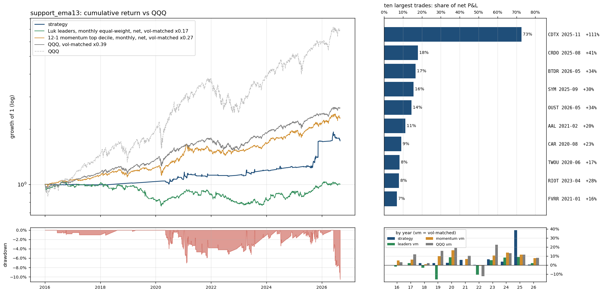

# `support_ema13`: the pullback level moved to the 13 EMA (slower, fewer touches)

Same as `full` (see `results/full/summary.md`) except: `support` 'ema9' -> 'ema13'.

Sample 2016-01-04 to 2026-08-31, starting capital $100,000, code `cb16764382`.  
Entry `close_confirm` on the `ema13` pullback, 0.5% of the account at risk per trade, at most 10 positions and 280% gross, market filter `qqq_9>21`, slippage `nbbo`, stop fill `minute_open`, financing T-bill + 1.5%; idle cash earns the T-bill rate.
- note: 73 candidate stock-days were queried and had no eligible print (empty)
- note: 7844 of 324807 candidate stock-days were too thinly traded for close_confirm (min_bars / max_stale_minutes)

## Headline

| trades | win rate | avg win | avg loss | payoff | avg trade | profit/loss ratio | median hold win / loss (days) | avg % invested | longest underwater |
|---|---|---|---|---|---|---|---|---|---|
| 187 (18/yr) | 35% | 7.4% | -2.5% | 2.9 | 0.93% | 1.65 | 2 / 2 | 3% | 2.2 yr |

Avg % invested = capital utilisation: market value of open positions / net asset value, averaged over all trading days (the rest earns the T-bill rate); profit/loss ratio = gross profits / gross losses.

The strategy against passive benchmarks, all after costs, all on daily returns. 6-factor alpha is the intercept of daily excess returns regressed on the Fama-French factors (market, size, value, profitability, investment, momentum), times 252: the return per year the factor exposures do not explain; t uses Newey-West errors (5 lags); beta is the market loading.

|  | CAGR | vol | Sharpe | max drawdown | 6-factor alpha / yr (t) | market beta |
|---|---|---|---|---|---|---|
| **strategy** | 5.3% | 8.6% | 0.37 | -11% | 3.2% (1.2) | 0.01 |
| QQQ (total return) | 19.9% | 22.3% | 0.83 | -35% | 3.0% (1.9) | 1.11 |
| QQQ, vol-matched x0.39 | 9.4% | 8.6% | 0.83 | -14% | 1.2% (1.9) | 0.43 |
| 12-1 momentum top decile (87 names), net | 21.0% | 32.1% | 0.68 | -46% | 7.5% (1.7) | 1.17 |
| momentum, vol-matched x0.27 | 8.1% | 8.6% | 0.68 | -13% | 2.0% (1.7) | 0.31 |
| universe hold: Luk leader screen (16 names), net | -19.2% | 50.2% | -0.22 | -95% | -19.3% (-1.6) | 0.90 |
| universe hold, vol-matched x0.17 | 0.0% | 8.6% | -0.22 | -26% | -3.3% (-1.6) | 0.15 |

Passive benchmarks: equal-weight portfolios in the same liquidity pool (common stocks, price >= $5, 20-day dollar volume >= $50M), selected on the day before each month end, bought at the month end's close and held for the month, net of the same spread table plus commission. Vol-matched = a fraction k of the benchmark, chosen so the realised volatility equals the strategy's, with the rest in T-bills. Sharpe = annualised mean of daily returns in excess of the T-bill rate over their standard deviation.

## By year

| year | strategy | QQQ | QQQ vm | momentum vm | universe vm | trades | win | avg trade | max DD in year |
|---|---|---|---|---|---|---|---|---|---|
| 2016 | -0.1% | 7.1% | 3.0% | 5.2% | -1.7% | 5 | 60% | -0.07% | -1% |
| 2017 | -0.5% | 32.7% | 11.7% | 5.9% | 2.2% | 1 | 0% | -2.16% | -1% |
| 2018 | 2.0% | -0.1% | 2.1% | 0.8% | -3.1% | 1 | 0% | -2.89% | -1% |
| 2019 | 2.2% | 39.0% | 15.7% | 9.9% | -15.8% | 2 | 0% | -1.16% | -0% |
| 2020 | 2.4% | 48.6% | 18.8% | 16.4% | 8.5% | 39 | 36% | 0.20% | -4% |
| 2021 | 5.7% | 27.4% | 10.2% | 6.6% | -0.5% | 32 | 38% | 0.55% | -7% |
| 2022 | 0.2% | -32.6% | -12.4% | -0.8% | -10.8% | 7 | 43% | -0.80% | -2% |
| 2023 | 6.2% | 54.9% | 22.6% | 10.7% | 5.4% | 21 | 29% | 0.69% | -5% |
| 2024 | 3.6% | 25.6% | 13.1% | 13.8% | 8.3% | 16 | 38% | -0.40% | -3% |
| 2025 | 38.7% | 20.8% | 11.6% | 11.4% | 8.9% | 37 | 41% | 4.07% | -3% |
| 2026 | 0.6% | 17.0% | 8.1% | 7.6% | 2.2% | 26 | 23% | 0.11% | -11% |

## Factor attribution

Daily excess returns on the Fama-French 5 factors plus momentum (Newey-West t-statistics).

|  | days | 6-factor alpha / yr | R² | mkt | smb | hml | rmw | cma | umd |
|---|---|---|---|---|---|---|---|---|---|
| all days | 2680 | 3.2% (t 1.2) | 0.01 | 0.01 (0.7) | 0.02 (1.7) | 0.03 (1.9) | -0.06 (-2.7) | -0.05 (-1.0) | 0.02 (1.4) |
| invested days only | 449 | 10.6% (t 0.7) | 0.04 | 0.10 (1.2) | 0.10 (1.0) | 0.16 (2.0) | -0.24 (-2.6) | -0.29 (-0.9) | 0.06 (1.2) |

## Largest trades

| ticker | entry | exit | exit reason | return | P&L | share of net P&L |
|---|---|---|---|---|---|---|
| CDTX | 2025-11-10 15:55 | 2025-12-02 09:30 | max_hold | +111% | $32,134 | 73% |
| CRDO | 2025-08-25 15:55 | 2025-09-16 09:30 | max_hold | +41% | $7,940 | 18% |
| BTDR | 2026-05-20 15:55 | 2026-06-08 09:30 | close_below_ema9 | +34% | $7,356 | 17% |
| SYM | 2025-09-30 15:55 | 2025-10-20 09:30 | close_below_ema9 | +30% | $6,919 | 16% |
| OUST | 2026-05-20 15:55 | 2026-06-08 09:30 | close_below_ema9 | +34% | $6,381 | 14% |
| AAL | 2021-02-12 15:55 | 2021-03-08 09:30 | close_below_ema9 | +20% | $5,007 | 11% |
| CAR | 2020-08-07 15:55 | 2020-08-28 09:30 | max_hold | +23% | $4,017 | 9% |
| TWOU | 2020-06-25 15:55 | 2020-07-17 09:30 | max_hold | +17% | $3,640 | 8% |
| RIOT | 2023-04-06 15:55 | 2023-04-20 09:30 | close_below_ema9 | +28% | $3,458 | 8% |
| FVRR | 2021-01-06 15:55 | 2021-01-20 09:30 | close_below_ema9 | +16% | $2,969 | 7% |

Each year's largest trade against the year's net P&L: 2016 CRC $262 / $-87; 2017 MDCO $-492 / $-492; 2018 FOSL $-544 / $-544; 2019 ROKU $-58 / $-348; 2020 CAR $4,017 / $2,287; 2021 AAL $5,007 / $5,639; 2022 STEM $489 / $-1,234; 2023 RIOT $3,458 / $1,426; 2024 RIOT $835 / $-1,643; 2025 CDTX $32,134 / $41,814; 2026 BTDR $7,356 / $-2,620.

## Risk

- Concentration: the top 5% of trades are 69% of gross wins; without the best 1% (1 trades) the average trade is 0.34% and the profit/loss ratio 1.18.
- Trade returns (net): p5 -4.6%, median -1.1%, p95 14.9%, best 109.9%, worst -7.4%.
- Gap-through stops: 12 trades (6.4%), $-10,978 of the $44,199 net; losses beyond twice the planned risk: 0; closed by delisting: 0; dividends credited $30; halted position-days: 0.
- Worst five: BTDR 2026-06-12 -7.4% (close_below_ema9); COHR 2026-06-30 -6.5% (stop_gap); AEVA 2026-06-22 -6.3% (stop_gap); CLSK 2026-06-04 -5.3% (close_below_ema9); BEEM 2021-01-22 -5.1% (stop).
- Block bootstrap (20-day blocks, 2000 draws): Sharpe 90% interval [-0.06, 0.72], max drawdown median -8%, 5th percentile -14%.
- Capacity (position / 20-day dollar volume, sizing scaled to a fixed account): median 0.01% at $100,000; at $1M median 0.14%, 0% of trades above 1%.
- Worst day -4.6% (2026-06-05); days below -5%: 0; max simultaneous positions 4.

## Execution and costs

- Stop width median 2.8%; planned loss per trade 0.5% of the account.
- Entry half-spread by liquidity tier: $30-100M 0.046% (n=74, avg trade 1.94%); >$100M 0.041% (n=113, avg trade 0.27%).
- NBBO quotes (last quote before the fill minute) found for 100% of spread-paying fills (the rest use the tier table); exits with an exact minute: 100%.

| cost scenario | avg trade | profit/loss ratio | CAGR | Sharpe | max drawdown |
|---|---|---|---|---|---|
| zero slippage (commissions and fees only) | 1.05% | 1.79 | 5.7% | 0.42 | -10% |
| as specified (slippage=nbbo, stop fill=minute_open, margin T-bill+1.5%) | 0.93% | 1.65 | 5.3% | 0.37 | -11% |
| conservative (0.2% per side, stop slip 0.5%, 8% margin) | 0.49% | 1.30 | 3.8% | 0.21 | -12% |
