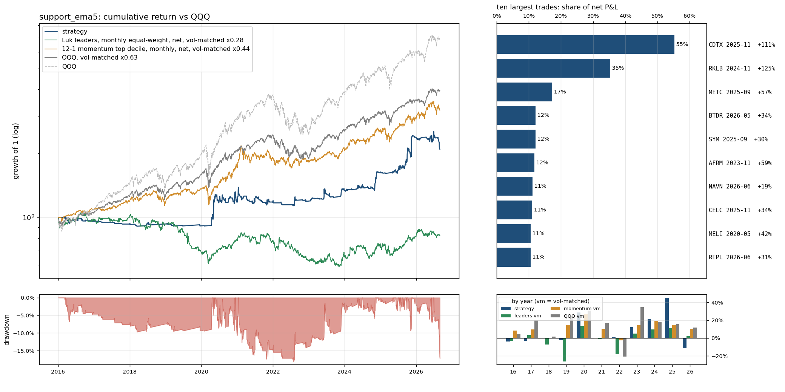

# `support_ema5`: the pullback level moved to the 5 EMA (faster, more touches)

Same as `full` (see `results/full/summary.md`) except: `support` 'ema9' -> 'ema5'.

Sample 2016-01-04 to 2026-08-31, starting capital $100,000, code `cb16764382`.  
Entry `close_confirm` on the `ema5` pullback, 0.5% of the account at risk per trade, at most 10 positions and 280% gross, market filter `qqq_9>21`, slippage `nbbo`, stop fill `minute_open`, financing T-bill + 1.5%; idle cash earns the T-bill rate.
- note: 5 EMA support: only the touches inside the 9 EMA download zone are observed (the 5 EMA sits above the 9 in an uptrend); entry count is a lower bound
- note: 73 candidate stock-days were queried and had no eligible print (empty)
- note: 7844 of 324807 candidate stock-days were too thinly traded for close_confirm (min_bars / max_stale_minutes)

## Headline

| trades | win rate | avg win | avg loss | payoff | avg trade | profit/loss ratio | median hold win / loss (days) | avg % invested | longest underwater |
|---|---|---|---|---|---|---|---|---|---|
| 474 (45/yr) | 22% | 14.0% | -3.0% | 4.6 | 0.78% | 1.27 | 10 / 2 | 12% | 4.1 yr |

Avg % invested = capital utilisation: market value of open positions / net asset value, averaged over all trading days (the rest earns the T-bill rate); profit/loss ratio = gross profits / gross losses.

The strategy against passive benchmarks, all after costs, all on daily returns. 6-factor alpha is the intercept of daily excess returns regressed on the Fama-French factors (market, size, value, profitability, investment, momentum), times 252: the return per year the factor exposures do not explain; t uses Newey-West errors (5 lags); beta is the market loading.

|  | CAGR | vol | Sharpe | max drawdown | 6-factor alpha / yr (t) | market beta |
|---|---|---|---|---|---|---|
| **strategy** | 7.2% | 14.1% | 0.40 | -18% | 5.1% (1.1) | 0.07 |
| QQQ (total return) | 19.9% | 22.3% | 0.83 | -35% | 3.0% (1.9) | 1.11 |
| QQQ, vol-matched x0.63 | 13.8% | 14.1% | 0.83 | -23% | 1.9% (1.9) | 0.70 |
| 12-1 momentum top decile (87 names), net | 21.0% | 32.1% | 0.68 | -46% | 7.5% (1.7) | 1.17 |
| momentum, vol-matched x0.44 | 11.5% | 14.1% | 0.68 | -22% | 3.3% (1.7) | 0.51 |
| universe hold: Luk leader screen (16 names), net | -19.2% | 50.2% | -0.22 | -95% | -19.3% (-1.6) | 0.90 |
| universe hold, vol-matched x0.28 | -1.8% | 14.1% | -0.22 | -44% | -5.4% (-1.6) | 0.25 |

Passive benchmarks: equal-weight portfolios in the same liquidity pool (common stocks, price >= $5, 20-day dollar volume >= $50M), selected on the day before each month end, bought at the month end's close and held for the month, net of the same spread table plus commission. Vol-matched = a fraction k of the benchmark, chosen so the realised volatility equals the strategy's, with the rest in T-bills. Sharpe = annualised mean of daily returns in excess of the T-bill rate over their standard deviation.

## By year

| year | strategy | QQQ | QQQ vm | momentum vm | universe vm | trades | win | avg trade | max DD in year |
|---|---|---|---|---|---|---|---|---|---|
| 2016 | -3.8% | 7.1% | 4.8% | 8.5% | -3.0% | 26 | 27% | -1.04% | -7% |
| 2017 | -3.1% | 32.7% | 19.7% | 9.7% | 3.4% | 6 | 0% | -2.66% | -3% |
| 2018 | 0.1% | -0.1% | 1.5% | -0.5% | -7.0% | 9 | 11% | -1.53% | -3% |
| 2019 | -2.0% | 39.0% | 24.6% | 14.8% | -26.1% | 12 | 8% | -1.71% | -3% |
| 2020 | 28.9% | 48.6% | 30.7% | 26.7% | 13.4% | 116 | 24% | 1.36% | -11% |
| 2021 | 0.4% | 27.4% | 17.0% | 10.1% | -1.2% | 69 | 19% | -0.10% | -17% |
| 2022 | 1.0% | -32.6% | -20.7% | -2.6% | -18.1% | 21 | 24% | -0.15% | -5% |
| 2023 | 12.3% | 54.9% | 34.8% | 14.2% | 5.2% | 31 | 23% | 2.47% | -9% |
| 2024 | 21.4% | 25.6% | 18.1% | 19.2% | 9.8% | 36 | 28% | 2.26% | -6% |
| 2025 | 45.3% | 20.8% | 15.5% | 14.8% | 10.8% | 80 | 31% | 2.59% | -9% |
| 2026 | -11.5% | 17.0% | 11.7% | 10.4% | 2.0% | 68 | 13% | -0.97% | -17% |

## Factor attribution

Daily excess returns on the Fama-French 5 factors plus momentum (Newey-West t-statistics).

|  | days | 6-factor alpha / yr | R² | mkt | smb | hml | rmw | cma | umd |
|---|---|---|---|---|---|---|---|---|---|
| all days | 2680 | 5.1% (t 1.1) | 0.04 | 0.07 (3.8) | 0.12 (3.6) | 0.01 (0.2) | -0.15 (-3.4) | -0.03 (-0.5) | 0.01 (0.6) |
| invested days only | 1017 | 6.4% (t 0.6) | 0.12 | 0.36 (6.1) | 0.21 (2.4) | 0.02 (0.3) | -0.33 (-3.4) | -0.06 (-0.4) | 0.03 (0.7) |

## Largest trades

| ticker | entry | exit | exit reason | return | P&L | share of net P&L |
|---|---|---|---|---|---|---|
| CDTX | 2025-11-10 15:55 | 2025-12-02 09:30 | max_hold | +111% | $44,187 | 55% |
| RKLB | 2024-11-04 15:55 | 2024-11-25 09:30 | max_hold | +125% | $28,250 | 35% |
| METC | 2025-09-17 15:55 | 2025-10-08 09:30 | max_hold | +57% | $13,759 | 17% |
| BTDR | 2026-05-20 15:55 | 2026-06-08 09:30 | close_below_ema9 | +34% | $9,651 | 12% |
| SYM | 2025-09-30 15:55 | 2025-10-20 09:30 | close_below_ema9 | +30% | $9,619 | 12% |
| AFRM | 2023-11-21 15:55 | 2023-12-13 09:30 | max_hold | +59% | $9,395 | 12% |
| NAVN | 2026-06-23 15:55 | 2026-07-15 09:30 | max_hold | +19% | $8,947 | 11% |
| CELC | 2025-11-07 15:55 | 2025-12-01 09:30 | max_hold | +34% | $8,859 | 11% |
| MELI | 2020-05-04 15:55 | 2020-05-26 09:30 | max_hold | +42% | $8,437 | 11% |
| REPL | 2026-06-12 15:55 | 2026-07-07 09:30 | max_hold | +31% | $8,405 | 11% |

Each year's largest trade against the year's net P&L: 2016 MDVN $2,795 / $-3,821; 2017 MDCO $-468 / $-2,951; 2018 CRC $1,964 / $-2,138; 2019 ETSY $780 / $-4,171; 2020 MELI $8,437 / $32,406; 2021 SPCE $6,738 / $-7,113; 2022 SWAV $8,312 / $866; 2023 AFRM $9,395 / $8,900; 2024 RKLB $28,250 / $21,393; 2025 CDTX $44,187 / $67,946; 2026 BTDR $9,651 / $-31,410.

## Risk

- Concentration: the top 5% of trades are 64% of gross wins; without the best 1% (4 trades) the average trade is 0.16% and the profit/loss ratio 0.95.
- Trade returns (net): p5 -4.8%, median -2.6%, p95 21.5%, best 109.9%, worst -14.4%.
- Gap-through stops: 39 trades (8.2%), $-54,613 of the $79,907 net; losses beyond twice the planned risk: 9; closed by delisting: 0; dividends credited $590; halted position-days: 0.
- Worst five: SYRE 2026-08-20 -14.4% (stop_gap); BOX 2021-04-07 -10.3% (stop_gap); CPE 2020-12-16 -9.9% (stop_gap); RUN 2025-08-28 -8.2% (stop_gap); ECA 2016-04-15 -7.9% (stop_gap).
- Block bootstrap (20-day blocks, 2000 draws): Sharpe 90% interval [-0.01, 0.90], max drawdown median -20%, 5th percentile -33%.
- Capacity (position / 20-day dollar volume, sizing scaled to a fixed account): median 0.02% at $100,000; at $1M median 0.15%, 0% of trades above 1%.
- Worst day -6.5% (2026-06-05); days below -5%: 3; max simultaneous positions 10.

## Execution and costs

- Stop width median 2.8%; planned loss per trade 0.5% of the account.
- Entry half-spread by liquidity tier: $30-100M 0.056% (n=200, avg trade 0.94%); >$100M 0.037% (n=274, avg trade 0.67%).
- NBBO quotes (last quote before the fill minute) found for 100% of spread-paying fills (the rest use the tier table); exits with an exact minute: 100%.

| cost scenario | avg trade | profit/loss ratio | CAGR | Sharpe | max drawdown |
|---|---|---|---|---|---|
| zero slippage (commissions and fees only) | 0.96% | 1.38 | 8.7% | 0.50 | -16% |
| as specified (slippage=nbbo, stop fill=minute_open, margin T-bill+1.5%) | 0.78% | 1.27 | 7.2% | 0.40 | -18% |
| conservative (0.2% per side, stop slip 0.5%, 8% margin) | 0.27% | 1.04 | 2.8% | 0.10 | -25% |
